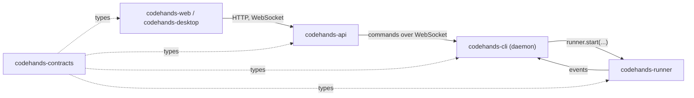

# Working across the repos

## Who calls whom (week 1)

## Rules

1. **Agree the shape first, then build alone.** Every shape two repos share lives in `codehands-contracts`.
2. **Build against a stand-in.** Every repo that others call ships a fake (the runner has `createFakeRunner()`, the daemon has its fake mode). Nobody waits for anybody.
3. **Changing a contract:** a PR to `codehands-contracts` that every consuming owner approves. Bump the version and tag it (`v0.2.0`). Update your stand-in in the same week. After the Friday Oct 23 freeze, changes batch into the Wednesday sync.
4. **Pin versions.** Depend on a tag, never on `main`.
5. **Only change your own repos.** For anything else, open a PR to its owner.
6. **Plug in on Fridays** (every day in week 1). Swap one stand-in at a time. If something breaks, write it down and keep the stand-in.

## In each repo

- Branch per Linear issue, e.g. `tahira/cod-12-runner-start`. The PR title carries the issue id so merging closes it.
- `main` is always green. CI runs `pnpm build` and `pnpm test` on every PR.
- Node 22, pnpm 10, TypeScript. Python only for evals and model serving.
- No API keys in code, events, logs or diffs.
