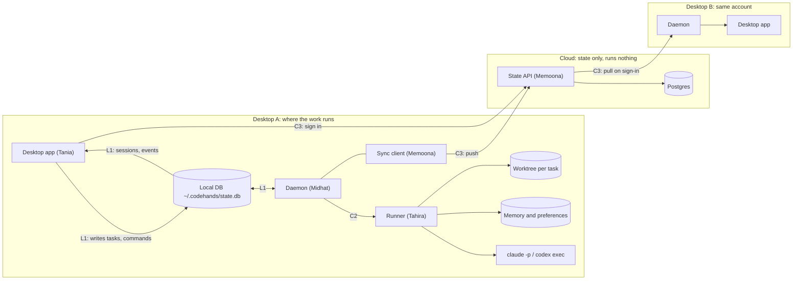

# Code Hands AI

A local-first coding agent platform. It takes a repository-level task, plans it, implements it, tests it, reviews it, and hands a person a change to approve. Built over six months, Oct 19, 2026 to Apr 18, 2027.

This repo holds the plan, the roadmap, the weekly guides and the decisions. Code lives in one repo per part (see [decision 0001](decisions/0001-separate-repos.md)).

## Start here

| If you want | Read |
| --- | --- |
| The whole plan | [plan/six-month-sig-build-plan.md](plan/six-month-sig-build-plan.md) |
| What ships when | [roadmap/README.md](roadmap/README.md) |
| Your week | [weeks/](weeks/) |
| How repos depend on each other, how to change a contract | [CONTRIBUTING.md](CONTRIBUTING.md) |
| Why we decided something | [decisions/](decisions/) |
| The Linear import | [plan/linear-import.csv](plan/linear-import.csv) |

## Repos

| Repo | Owner | What |
| --- | --- | --- |
| [codehands-docs](https://github.com/devweekends/codehands-docs) | everyone | This repo: plan, roadmap, decisions, the design below |
| [codehands-contracts](https://github.com/devweekends/codehands-contracts) | Midhat, Tahira (every consumer approves changes) | Shared types: local DB schema, `Runner`, cloud API, session states |
| [codehands-desktop](https://github.com/devweekends/codehands-desktop) | Tania | The desktop app |
| codehands-daemon (to be created) | Midhat | The laptop daemon, the local DB and the `codehands` CLI, moved out of `codehands-backend` |
| [codehands-agent](https://github.com/devweekends/codehands-agent) | Tahira | The runner: agent CLIs, models, worktrees, memory |
| [codehands-backend](https://github.com/devweekends/codehands-backend) | Memoona | The cloud state API and the sync client |
| [codehands-web](https://github.com/devweekends/codehands-web) | none | Empty. No role in the current design |

## Design

Everything a task needs runs on the desktop: the desktop app, a local database, the daemon and the runner. The cloud only stores state, so signing in on another machine brings your sessions, memory and preferences with you. Nothing runs in the cloud, and repos, credentials and big files never leave the machine they were made on.

### Who owns what

| Owner | Part | Owns | Writes | Publishes |
| --- | --- | --- | --- | --- |
| Tania | Desktop app | Sign-up and login screens, token in the OS keychain, signed-in state, projects, new task form with model per phase, session list and live view, diff and approve. Comes back exactly as you left it after a restart | `tasks`, `commands` | |
| Midhat | Daemon | Local DB schema and migrations, the task watcher, preflight checks (CLI installed, logged in, rate or usage limit), calling the runner, the `codehands` CLI | `sessions`, `events`, `provider_status` | L1 |
| Tahira | Runner | Claude Code and Codex adapters, model per phase, a git worktree per task, stop and resume, naming provider errors, memory and user preferences, two models on one task | | C2 |
| Memoona | Cloud state API | Auth and device tokens, the synced schema, push and pull endpoints, the `@codehands/sync` client the daemon loads, hosting | Postgres | C3 |

Two rules keep the parts apart:

1. **One process does work: the daemon.** The runner and the sync client are libraries it loads. Each owner owns their library; Midhat owns the loop that calls them.
2. **One writer per local table.** The app writes `tasks` and `commands`. The daemon writes everything else, including rows the sync client pulls down.

### Contracts

All live in [codehands-contracts](https://github.com/devweekends/codehands-contracts). Each ships a stand-in so nobody waits.

| ID | Contract | What it defines | Owner | Used by | Stand-in |
| --- | --- | --- | --- | --- | --- |
| L1 | Local DB | Tables in `state.db`, columns, and which process may write each | Midhat | Tania, Memoona | A fake writer that fills sessions and events; `codehands task add` |
| C2 | Runner | `start`, `stop`, `resume`, `diff`, `approve`, `reject`; `StartOptions` with models per phase, preferences and memory; events including `provider.status` | Tahira | Midhat | `createFakeRunner()` |
| C3 | Cloud API | Sign up, log in, log out, device tokens; `push(changes)`, `pull(cursor)`, record versions | Memoona | Tania, Midhat | A mock server with in-memory accounts |
| C5 | Sessions | `Session`, `Command`, `Project`, the seven statuses and the legal moves | Midhat, Tahira | everyone | Sample rows |

### Provider failures

The runner reads failures from the agent's output and reports them as one `provider.status` event. The daemon checks the same states before it starts a task, so a task never stalls halfway.

| State | What happened | The app shows |
| --- | --- | --- |
| `rate_limited` | 429, or the agent says the limit is hit | When it can retry, and offers the other agent |
| `auth_expired` | Logged out, or the CLI login or key expired | Sign in to that agent again on this machine |
| `usage_limit` | The plan's usage cap is reached | When it resets |
| `subscription_inactive` | The subscription lapsed | That the agent is unavailable |
| `down` | 5xx or timeouts | That the provider is down |

### What syncs to another machine

| Data | Synced | How |
| --- | --- | --- |
| Account, devices | Yes | Logging out on one machine revokes only that machine's token |
| Projects | Yes | By repo identity (hash of the origin URL), not folder path. Each machine maps it to its own clone |
| Sessions | Yes | Prompt, agent, models, status, branch name, cost, times |
| Events | Yes | Append only, keyed by session and number, so a resend is harmless. Raw agent output stripped |
| Diff | Small ones | Up to a size cap, so the other machine can read the change |
| Memory | Yes | Repo notes, task summaries, user memory as versioned records |
| Preferences | Yes | Default agent, model per phase, app settings. Last write wins |
| Repo files, worktrees | Never | Each machine uses its own clone. A branch reaches another machine through GitHub |
| Credentials | Never | Agent logins, API keys, the app token. Each machine signs in itself |
| Raw output, big logs | Never | Stay in `~/.codehands/` on the machine that made them |
