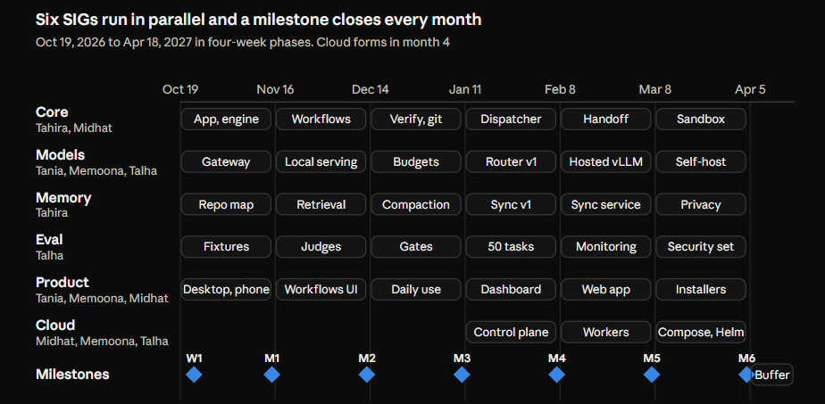

# Code Hands AI: Six-Month SIG Build Plan

15 Oct 2026 · @Someone

## What we are building

Code Hands AI is a local-first coding agent platform that takes a repository-level task, plans it, implements it, tests it in a sandbox, reviews it, and hands a human a change to approve. It runs each step on the model that is cheapest for that step, remembers what it learns about a repo and a user, and by month 6 runs the same way on a laptop, in our cloud, or on a customer's own servers with their own models.

Five people build it in six months, Oct 19, 2026 to Apr 18, 2027, organised as six Special Interest Groups (SIGs). Each SIG owns a package behind a frozen contract, ships against mocks of everyone else's package, and demos something runnable every Friday.

| Principle | What it means in practice |
| --- | --- |
| The CLI is the product | `codehands` runs everything. The desktop app, the web app and the phone view are clients that spawn or call the CLI daemon. Anything the UI can do, the CLI can do in JSON mode |
| Phases exchange artifacts, not chat state | Analyze, plan, implement, test, review each read and write files (`context.md`, `plan.md`, `diff.patch`, `test-report.json`, `review.md`). This is what makes models interchangeable per phase |
| Nothing runs on the host | Repository commands run in a disposable sandbox (Docker first, microVM later). The sandbox manager, not the model, creates and destroys containers |
| Every model call is measured | Tokens, cost, latency, outcome and the phase it served are recorded on every call from month 1. Routing in month 4 is trained on this data, and cost per solved task sits next to pass rate in every report |
| Bring your own keys | Users sign in with their own provider accounts. Keys stay on their machine. We never pool accounts |
| Memory is a first-class system | Repo memory, task memory and user memory are stored locally from month 2 and synced to the cloud in month 5, so a run on another device starts with the same knowledge |
| Contracts first, mocks second, real third | Every interface is typed and mocked in week 1 so no SIG waits on another |
| A demo every Friday | Each SIG shows something that runs. If a week slips, scope is cut, the demo is not |

Three inputs were merged into this plan: the Code Hands AI research report and 20-day local MVP, the three-person Multi-Model Orchestrator six-month plan, and the new direction for five people, SIGs, memory, multi-model collaboration, quantization, self-hosting and a Gantt chart. The 20-day MVP becomes month 1 of SIG Core. The nine modules of the orchestrator plan are regrouped under six SIGs.

## Start here: who does what

Read this section first. It explains what we are building in simple words, what the words in this doc mean, who does what, and what each person does every week in month 1. Everything after this section is detail you can come back to.

### What we are building, in simple words

You give Code Hands AI a coding task, for example "fix the date bug in this repo". It reads the repo, makes a plan, changes the code, runs the tests, checks its own work, and shows you the change so you can approve it. Think of a junior developer who never gets tired, and who always shows you the diff before anything is merged.

Three ideas make it different from just using Claude Code or Cursor:

1. **It uses a different AI model for each step.** A cheap model reads the repo, a strong model makes the plan, a mid model writes the code. That keeps cost down without losing quality.
2. **It remembers.** The second task on a repo goes better than the first, because it remembers how the repo works and what went wrong last time.
3. **It runs anywhere.** First on your laptop, later on our cloud, later on a company's own servers with their own models.

The work is split into layers. Each layer talks to the next one through an agreed interface, so each person can build their layer without waiting for the others.

Read it top down: a person uses the app or the CLI, which ask the daemon API, which drives the engine, which uses the sandbox, the models and memory. Eval sits beside everything and measures it.

```text
        Desktop app / Phone web app / CLI
                      │
                  Daemon API
                      │
                    Engine ───────────────┐
          ┌───────────┼───────────┐       │  Eval (measures
       Sandbox      Models      Memory    │  everything)
                                          ┘
```

### Words we use

| Word | What it means here |
| --- | --- |
| Task | One coding job the user asks for, like "add a test for the login function" |
| Run | One attempt at a task, from start to finish |
| Phase | One step of a run: analyze, plan, implement, test, review |
| Artifact | The file a phase leaves behind for the next one: `context.md`, `plan.md`, `diff.patch`, `test-report.json`, `review.md` |
| Engine | The code that moves a run from phase to phase, saves progress, and resumes after a crash |
| Daemon | The engine running in the background as a small local server. Everything else talks to it |
| Daemon API | The list of requests the daemon answers: start a run, list runs, stream events, approve, cancel |
| CLI | The `codehands` command you type in a terminal. It talks to the daemon |
| Sandbox | A throwaway Docker container where the repo's commands run, so nothing the AI does can touch your computer |
| Gateway | The code that sends a request to any AI model (Claude, GPT, a local Qwen) in one common shape |
| Registry | A file listing every model we use, with its price and limits |
| Router | The code that picks which model each phase uses |
| Memory | What the system remembers about a repo, past runs and the user |
| Eval | A set of test tasks we run often to measure how good and how cheap the system is |
| Trace | A record of everything that happened in one run, step by step, with time and cost |
| Contract | An agreed interface between two layers, written as TypeScript types. It is what lets people work in parallel |
| Fake (mock) | A stand-in for a layer that is not built yet. It answers like the real thing with canned data |
| Spike | A small throwaway experiment to learn something before building it for real |
| SIG | Special Interest Group, one area of the product with an owner |

### What "Product" means

Product is everything a person sees or touches. In month 1 that is only the desktop app. The CLI and the daemon API are part of Core, because the app and the CLI both sit on top of them. Connectors and the web app come later, once the core works.

| Surface | What it is | Owner | Starts | Why then |
| --- | --- | --- | --- | --- |
| CLI | The `codehands` command in a terminal | Midhat (Core) | Week 1 | It is the first way to run anything, and the tests and apps use the same code |
| Daemon and state API | The background program on the laptop, and the small API on our Linux server that keeps session state and passes commands | Midhat (Core) | Week 1 | Every screen depends on it |
| Desktop app | The window where you pick a repo, start a task, watch it live, review the change and approve | Tania (Product) | Week 1 | The fastest way to use it at your desk |
| Phone web app | Start, watch and approve tasks running on your laptop, from anywhere. A web app on Vercel, added to the phone's home screen | Memoona (Product) | Week 1 | Proves remote use works from day one, with only a small server of ours |
| Cost on screen | What each task and each step cost, in both apps | Memoona (Product) | Week 1 | Cost is one of our main goals, so it is visible from the start |
| Web app on a desktop browser | The same web app on a bigger screen | Memoona | Week 2 | Same code, so it comes almost free |
| Connectors | GitHub first, then Slack, Linear, Vercel, AWS, Olostep | Midhat (Product) | Month 3 | They only make sense once a task works well end to end |
| SDK and docs site | For people who want to build their own workflows on top | Midhat | Month 4 and month 6 | Needs the daemon to stop changing first |

Docs follow the same rule. The only doc in month 1 is the README quickstart in week 4, written once there is something to start. Bigger docs come in month 6.

### Months 1 to 3: everything runs on your laptop

No task ever runs off the laptop until month 5. Each person runs the whole product on their own machine: the desktop app opens on your laptop, starts the daemon in the background on your laptop, and every task runs on your laptop. From week 1 the state of each session (its status, what happened, the change, the cost) is copied to a small API on our own Linux server, so the phone can show it and send commands. The server stores state and passes commands, it never runs a task. The phone screen is a web app on Vercel. The only other thing leaving the laptop is the call to an AI provider.

| Part | Where it runs in months 1 to 3 | Where it moves later |
| --- | --- | --- |
| Desktop app | Your laptop, started with `pnpm dev` while building, an installer in month 6 | Stays on the laptop |
| Phone app | A web app on Vercel, added to the phone's home screen, from week 1. It only talks to our state API | A native app later, only if the web app is not enough |
| CLI, daemon and every task | Your laptop | The same daemon also runs as a cloud worker from month 5, so a task can continue with the laptop closed |
| Session state | On the laptop in SQLite, copied to Postgres on our Linux server so the phone can see it | Same |
| Sandbox | Week 1: a separate copy of the repo per task. From week 2: Docker on your laptop | Cloud sandboxes per task from month 5 |
| Memory | Files and SQLite in `~/.codehands/` | Synced and encrypted from month 5 |
| Traces | Langfuse on our Linux server, plus a local file | Same, with our own dashboards in month 5 |
| AI models | Claude Code and Codex with the team keys in week 1, our own model code from week 2, Qwen on the team GPU machine | Our own hosted models from month 5 |
| API keys | Your OS keychain | Still your OS keychain. Keys never go to the cloud |

**What each person installs in week 1:** Node 22 and pnpm, Docker Desktop, the Rust toolchain (Tauri needs it to build the desktop app), Git, Python with uv (Talha for evals, anyone else only to run them), and Claude Code, Codex CLI and Aider for Midhat's adapters. 16 GB of RAM is enough. Nobody needs a GPU on their laptop, the team shares one GPU machine for the local model.

**How you start it once the repo is set up:** `pnpm install`, then `pnpm dev`. That builds the packages, starts the daemon and opens the desktop app pointed at it. `pnpm dev --mock` does the same with fake models and no Docker, for working on screens without spending anything.

**Why local first:** it is free, it is fast to change, nobody waits on infrastructure, and it forces the engine to save its state properly, which is exactly what moving it to the cloud in month 5 needs.

### Week 1 sprint: a usable app in five days (Oct 19 to 23)

By Friday Oct 23, anyone on the team can pick up their phone, start a coding task on their laptop at home, watch it live, read the change and approve it. All the work runs on the laptop. One small Linux server of ours holds the state of the sessions, and the phone screen is a web app on Vercel. This week is our speed test: if five people ship this in five days, the six-month plan is realistic.

How it works this week:

1. The laptop runs a small background program (the daemon). For each task it makes a separate copy of the repo with git worktree and runs Claude Code, or Codex, inside it with no screen. We do not build our own agent this week, we wrap a good one and build everything around it.
2. Every session, what happened in it, the code change and the cost are saved on the laptop and copied to a small API with a Postgres database on our own Linux server. The laptop keeps one outgoing connection open to it. That server is the only thing off the laptop, and it never runs a task.
3. The desktop app talks to the daemon on the laptop. The phone uses a web app hosted on Vercel, which reads sessions from our API. To start, stop or approve from the phone, the web app sends a command to the API, and the laptop picks it up over its open connection and acts on it. The phone never connects to the laptop directly, so there are no open ports and no tunnels.
4. Every session is also sent to Langfuse, running on the same Linux server, with its steps, time and cost, and five practice tasks are scored by a script.

Rules for the week:

- One small Linux server of ours, set up with Docker Compose: Postgres, the state API, Langfuse, and Caddy for HTTPS. The phone web app on Vercel. Nothing else. A Linux VPS with 4 vCPU and 8 GB of memory is enough for the week, or a Linux machine we already have with a public address.
- API keys never leave the laptop, and the server never runs code.
- The laptop only acts on commands from the signed-in user, for repos registered on that laptop. The API checks the user on every request and only returns their own laptops and sessions.
- The code change and logs are stored on our server so the phone can show them, so use only our own repos this week.
- Cut scope, never the Friday demo.

The five tables everyone builds on, agreed Monday morning:

| Table | What one row is | Written by | Read by |
| --- | --- | --- | --- |
| `devices` | A laptop signed in to an account | Daemon | Both apps |
| `projects` | A repo on a laptop where tasks may be started | Desktop app | Phone, daemon |
| `sessions` | One task: its status, agent, model, cost, the change | Daemon | Both apps, evals |
| `events` | One thing that happened in a session: a message, a file read, a file changed, a test result | Daemon | Both apps, tracing |
| `commands` | A request from an app: start, stop, approve, reject | Both apps | Daemon |

Who does what this week:

| Person | Builds this week | Can show on Friday |
| --- | --- | --- |
| Tahira | The session runner: a worktree per task, Claude Code run with no screen, its output turned into events, stop, resume, the change as a diff, approve commits it to a branch, reject throws it away. Codex as a second agent on Thursday. First memory: a notes file per repo given to every session, and a short summary saved after each one | A task typed in the terminal runs in its own copy of the repo, events stream, and approve puts the change on a branch |
| Midhat | The daemon and the cloud link: the `codehands` command, the local connection the desktop app uses, the state API on our Linux server (a small Node API with Postgres), the five tables, sign in with GitHub, a live connection for the laptop and the web app, sessions and events copied up, commands passed down, a laptop paired to an account | A start command written from anywhere begins a task on the laptop, and its events reach the server within a second |
| Tania | The desktop app: sign in, add a repo by picking a folder, start a task, choose Claude Code or Codex and the model, watch it live, read the change, approve or reject | The whole loop from the desktop app |
| Memoona | The phone web app on Vercel (Next.js, added to the home screen): sign in, list sessions, open one and watch it live, start a task in a registered repo, approve, stop. Cost per session from what Claude Code reports, shown in both apps, plus a small price list for Codex | Away from the laptop, on a phone: start, watch, approve, see the cost |
| Talha | The Linux server ready on Monday: Docker Compose, Caddy for HTTPS, Postgres, Langfuse. Then tracing and evals: each session sent to Langfuse with its steps, time and cost. Five practice tasks with hidden tests and a script that runs them through the command and scores them. Team accounts for Anthropic, OpenAI and Vercel with spending caps | A scorecard for the five tasks, a trace for each, and our first numbers: solved, time, cost |

Day by day, with an end-of-day plug-in:

| Day | Build | End of day, these plug in |
| --- | --- | --- |
| Mon Oct 19 | Repo, accounts and the Linux server set up. The five tables agreed and created. Everyone builds against sample rows on the server | The desktop app and the phone web app list sample sessions from the server (Tania, Memoona, Midhat, Talha) |
| Tue Oct 20 | Claude Code runs with no screen and gives events. Sessions and events copy up. Practice tasks written | A task from the terminal shows up live on the server (Tahira, Midhat) |
| Wed Oct 21 | Commands come down. Apps start tasks and show them live. Cost recorded per session | The desktop app starts a task and watches it, the phone shows the same session live (Tania, Memoona, Midhat, Tahira) |
| Thu Oct 22 | The change, approve and reject. Codex as a second agent. Traces in Langfuse. Eval script | The phone approves a change made on the laptop (Memoona, Midhat, Tahira). Every session has a trace (Talha) |
| Fri Oct 23 | Fix what broke, then the demo | Week 1 demo: from a phone away from the laptop, start, watch and approve a task, with its cost and trace. Eval scorecard shown |

Reading this week is only what you need, about an hour each:

| Person | Read |
| --- | --- |
| Tahira | Claude Code docs on headless mode (`-p`, `--output-format stream-json`, `--resume`), the git worktree page, the Codex CLI README section on `codex exec` |
| Midhat | The Fastify getting started page and its WebSocket plugin, a short guide to Postgres with Drizzle, the GitHub OAuth app docs |
| Tania | The Tauri create a project page, a short guide to WebSockets in the browser |
| Memoona | The Next.js getting started page, the Vercel guide to deploying Next.js, the Next.js page on the web app manifest (adding to the home screen), the cost fields in Claude Code's JSON output |
| Talha | The Docker Compose getting started page, the Caddy quickstart (automatic HTTPS), the Langfuse self-hosting with Docker Compose page, the promptfoo getting started page, the usage and cost fields in Claude Code's JSON output |

**What waits until later:** our own agent and the Docker sandbox (weeks 2 to 4), our own model code with several providers and a model per step (weeks 2 to 3), anything running on our own cloud (month 5), routing learned from data, quantized local models, OpenRouter or a model garden, microVMs, and connectors (month 3 onward). Weeks 2 to 4 replace pieces of this app one at a time with our own, while the phone and desktop keep working the whole time.

### Who owns what

| Person | Areas | What you build in month 1, in one line | First thing on Monday |
| --- | --- | --- | --- |
| Tahira | Core (engine), Memory | The engine: a task goes in, the agent plans, edits, tests in Docker and reviews, and the run survives a crash. Plus the first memory: what the system knows about a repo | Set up the repo, write the shared interfaces, run one command inside a Docker container with a timeout |
| Midhat | Core (CLI and daemon API), Product | The `codehands` command line, the daemon API the app talks to, and the adapters that run Claude Code, Codex and Aider inside our engine | Write the CLI skeleton and the fake daemon that serves recorded runs |
| Tania | Product (desktop app), Models (gateway) | The desktop app that shows a run live, and the adapters that talk to each model provider | Start the Tauri app against Midhat's fake daemon, and write the model request and response interface |
| Memoona | Models (registry, cost, router), Product (model screens) | The model registry with prices, the cost ledger on every call, the router that picks a model per phase, and the app screens that show cost and model choice | Write the registry file format and fill it with current prices |
| Talha | Eval and Observability, Models (serving, routing data, fine-tuning) | The test tasks, the tracing, the harness that scores every run, and a local open model running on a GPU | Write 10 fixture tasks with hidden tests, and set up tracing |

Where two or three people share an area, this is the split. Each line is one person's own responsibility, with one reviewer from the same area.

| Area | Who | Owns within the area |
| --- | --- | --- |
| Core | Tahira | Workflow engine, phase state machine, queue and leases, tools, sandbox manager, checkpoints and resume |
| Core | Midhat | The `codehands` CLI, the daemon's JSON-RPC API (ClientAPI), the fake daemon, external agent adapters (Claude Code, Codex CLI, Aider), and from month 4 the dispatcher and the worker image |
| Product | Tania | Desktop app: run view, logs, diff review, approvals, onboarding, installers |
| Product | Memoona | Model-facing screens: cost per run and phase, model per phase settings, budgets, the router explainer, and the web client in month 5 |
| Product | Midhat | CLI user experience, the connectors (GitHub, Slack, Linear, Vercel, AWS, Olostep) from month 3, SDK docs for people who build on the daemon API |
| Models | Tania | Provider adapters, streaming, prompt caching, fallback chains |
| Models | Memoona | Registry and prices, cost ledger, static router, router v1 with Talha's data, token budgets and spend caps |
| Models | Talha | Local serving (Ollama, vLLM), quantization, the routing dataset and classifier, multi-model experiments, fine-tuning |

Cloud has no single owner yet. Proposed: Midhat leads it from month 4 from the Core side (workers, dispatcher, compose and Helm), Memoona takes hosted GPU serving and rented GPUs, Talha takes monitoring. Until then the three cloud-readiness rules in the Cloud section apply to everyone.

### Month 1 for the whole team

Every week has the same shape. Saturday and Sunday before the week: the reading in your table, then a spike (a throwaway script under 200 lines that tries the idea). Monday to Thursday: build. Friday: 30 minutes of integration on main, then each person shows the outcome in their table. Month 1 reading is deliberately light: one or two short official quickstarts or explainer videos each weekend, nothing longer than an hour, and no papers. The harder material in the SIG learning kits later in the doc starts in month 2. If something still feels heavy, do the spike first and read only what you need to finish it.

| Week | Dates | What the team builds | What you can show on Friday |
| --- | --- | --- | --- |
| 1 | Oct 19 to 23 | The sprint above: a usable app with Claude Code doing the work, state on our Linux server, the desktop app and a phone web app on Vercel, traces and a first scorecard | Start, watch and approve a task from a phone, with its cost and trace |
| 2 | Oct 26 to 30 | Start replacing borrowed pieces with our own: tasks run inside a locked Docker box, our own engine moves a task through its steps, our own code talks to the AI models, every call has a price | Pick "Code Hands engine" instead of Claude Code in the app and watch it go step by step, with cost, on the phone too |
| 3 | Nov 2 to 6 | Our engine can read and change code and run tests. Choose the model per step. Compare our engine with Claude Code and Codex on ten tasks | Our engine fixes a small bug and the change shows on the phone. A table shows how it compares with Claude Code |
| 4 | Nov 9 to 13 | Make it hold up: crash recovery, a review step, tests that try to trick it, spending limits, a README | Milestone 1, shown by someone who did not build it, from a fresh download |

Memory stays with Tahira, so her table is the fullest. If it slips, the repo map moves to month 2 and nothing else.

### When we plug our work together

In week 1 the team plugs in at the end of every day, because the whole app has to work by Friday. From week 2 you build your part on your own all week, and on Fridays, for 30 minutes, two or three people swap a stand-in for the real thing. These are the only planned moments where your work depends on someone else's.

| When | What gets plugged together | Who | What you use before that | What a person can do after |
| --- | --- | --- | --- | --- |
| Every day of week 1 | The day-by-day plug-ins in the sprint table: apps on sample rows (Mon), terminal to the server (Tue), apps start tasks (Wed), phone approves (Thu), the demo (Fri) | Everyone, in the pairs listed there | Sample rows on the server | Use the whole app from a phone |
| Fri Oct 30 | Our engine as a choice next to Claude Code in both apps. Our own AI model code with prices and cost recording. Step recording for our engine | Tahira and Midhat. Tania and Memoona. Talha and Tahira | Claude Code does the work, canned AI answers for the engine | Run a task on our own engine from the phone and see its cost |
| Fri Nov 6 | The free local model as a provider. Model per step read by the engine. The test runner comparing all agents | Talha and Tania. Memoona and Tahira. Talha and Midhat | One paid model, fixed model per step | Fix a small bug with our engine on a free local model, and see how it compares |
| Fri Nov 13 | Everything together from a fresh download | Everyone | | Milestone 1 |

How to keep your work independent:

1. **Agree the shape first, then build alone.** In week 1, each pair writes down what one part sends and what it gets back. After that you only need the other person on plug-in Fridays.
2. **Build against a stand-in.** Every part has a fake version that answers with sample data. Build and test against it until your plug-in Friday. Nobody waits for anybody.
3. **Plug in on Fridays only.** Swap one stand-in at a time. If it breaks, write it down, keep the stand-in, and fix it the next week. Never hold up a demo for a broken plug-in.
4. **Change the shape only together.** If you need to send or receive something different, open a pull request that the other person approves, and update the stand-in in the same pull request.
5. **Own your folder.** Nobody changes another person's folder without a pull request to them.
6. **Sample mode always works.** `pnpm dev --mock` runs the whole product with stand-ins, so any screen or feature can be shown without the other parts running.

### Tracking in Linear

Every task in the month 1 tables is in the file [codehands_linear_import.csv](codehands_linear_import.csv) (142 issues, with the week 1 sprint broken into daily due dates and the end-of-day plug-ins, a sprint label on every week 1 issue, one issue per Friday plug-in from week 2, and the milestones written as what a person can do), plus the week 1 setup and one goal issue per person per area for months 2 to 6. Each issue says why it matters and when it is done, in plain words. Reading for a weekend is one learning issue, not several. Week 1 setup is only what blocks work on Monday: the repo, Linear, provider keys, the folder skeleton, basic CI and the shared interfaces. Docs start in week 4 with the README. Import it once, then the board is the source of truth and this doc is the plan.

| Linear setup | Value |
| --- | --- |
| Team | Code Hands AI, one team, five members plus the lead |
| Project | Code Hands AI, with six milestones M1 to M6 on their Friday dates |
| Cycles | Two weeks, starting Oct 19, 2026, so each cycle is two of the weeks in the tables |
| Labels | One per SIG: core, models, memory, eval, product, cloud. One per week in month 1: week-1 to week-4. One per month after: month-2 to month-6. Type labels: setup, learning, contracts, cli, desktop, gateway, adapters, cost, router, serving, security, docs, milestone, epic. The product label is only for screens people see, CLI and API work is labelled core and cli |
| Priority | Urgent for the Friday milestone issues and the week 1 setup, High for the week's main build, Medium for the rest |
| Due date | The Friday of the week for month 1, the last Friday of the month for the epics |
| Estimate | Points are days of a part-time week: 1 is a weekend item, 2 to 3 is a weekday build, 5 is a monthly epic |
| GitHub integration | Connect the repo so a PR titled with the issue id closes it on merge, and branch names come from Linear |
| Import | Settings, Import/Export, Import, CSV. Map Assignee to each member by name on the mapping screen, Labels are created on import |

In month 2 the lead breaks each month-2 epic into weekly issues in the last week of month 1, in the same four-column shape as the tables above.

### Tahira, month 1, week by week

**Your goal this month:** build the heart of the system. A task goes in, the engine walks it through analyze, plan, implement, test and review, the code changes happen inside a Docker container, and if the computer crashes halfway the run picks up where it stopped. You also start the memory: the system should learn the basics of a repo (its language, how to run its tests) so it does not have to guess every time.

**Why it matters:** everyone else builds on top of the engine. Tania's app shows it, Talha's tests measure it, Memoona's router picks models for it. That is why week 1 is about writing the agreed interfaces and fakes, so nobody waits for you.

**Working on your own:** in week 1 you only need a terminal and Claude Code, the runner works before anyone else's part does. From week 2 your engine is tested with canned AI answers until Tania's model code is ready, and it sends the same events as Claude Code, so the apps show it with no extra work. Memory is yours alone. You plug in daily in week 1, then on Oct 30 (your engine in both apps, Talha's step recording) and Nov 6 (Memoona's model per step).

**A first thought on how to approach it:** start with the dumbest version that works end to end, one fixture repo, one model, no memory, then make each phase better. A run that finishes badly teaches you more than a perfect phase that is not connected to anything.

| Week | Weekend before: read or watch, then try | Build, Monday to Thursday | What you can show on Friday |
| --- | --- | --- | --- |
| 1 (Oct 19 to 23) | The sprint reading: Claude Code headless mode, git worktree, `codex exec` | Sprint: the session runner around Claude Code and Codex, approve and reject, repo notes and session summaries | From the phone: a task runs on your laptop in its own copy of the repo, and approve puts the change on a branch |
| 2 (Oct 26 to 30) | Watch: Docker in 100 Seconds (Fireship). Read: the Docker getting started guide, the XState introduction to state machines (just the concepts page), the Drizzle SQLite quickstart. Try: run `npm test` inside a container with 1 GB of memory, no network and a 60-second limit | Run the repo's commands inside a locked Docker box. Start our own engine: it moves a task through analyze, plan, implement, test and review, saving each step, and sends the same events as Claude Code so both apps show it | Choose "Code Hands engine" in the app and watch a task move through its steps, with its tests running in a locked box |
| 3 (Nov 2 to 6) | Watch: a 10-minute SWE-agent or OpenHands demo video. Read: the first screen of the `git apply` man page, 20 minutes in the tree-sitter playground. Try: apply a patch from Node and make it refuse a path like `../secret` | Give our engine safe hands: read files, search, change code, all limited to the repo. Run the tests and save the result. If tests fail, try to fix twice. Memory: list the functions in a repo | Our engine fixes a small bug in a sample repo, and the change shows on the phone just like a Claude Code session |
| 4 (Nov 9 to 13) | Read: Stripe's short page on idempotent requests, the Letta quickstart (what core and archival memory mean). Try: kill your run mid-step with `kill -9`, restart, and see what it takes to continue | A review step. Save progress after every step so a crash loses nothing. Tests that try to trick or break it. Memory: the second task on a repo starts with what the first learned | Stop the laptop's daemon halfway through a task, start it again, and it finishes. A repo that tells the agent to misbehave gets nowhere |

### Tania, month 1, week by week

**Your goal this month:** the desktop app that a person actually uses, and the code that talks to the AI providers. By week 4 someone should open the app, pick a repo, start a task, watch it happen live, read the diff and approve it.

**Why it matters:** the milestone demo is shown from your app, and the gateway is how every phase talks to a model. If the gateway hides the differences between Claude, GPT and a local model well, swapping models becomes a one-line change for everyone else.

**Working on your own:** on Monday of week 1 you build the desktop app against sample rows from the server, so you never wait for the runner. From week 2 your model code is tested alone on your laptop with one real provider before Tahira's engine uses it. You plug in daily in week 1, then on Oct 30 (your model code in Tahira's engine, with Memoona's prices) and Nov 6 (Talha's local model as a provider).

**A first thought on how to approach it:** build the screens against recorded runs first. You do not need a working engine to make a good run view. When the real daemon is ready on a Friday, you swap the address and it should just work.

| Week | Weekend before: read or watch, then try | Build, Monday to Thursday | What you can show on Friday |
| --- | --- | --- | --- |
| 1 (Oct 19 to 23) | The sprint reading: Tauri create a project, WebSockets in the browser | Sprint: the desktop app, sign in, add a repo, start a task, pick Claude Code or Codex and the model, watch live, read the change, approve or reject | The whole loop from the desktop app |
| 2 (Oct 26 to 30) | Read: the xterm.js getting started page, the first page of Anthropic's tool use docs and OpenAI's function calling guide, the LiteLLM getting started page. Try: an xterm.js box that prints 10,000 lines without freezing | Desktop: live run screen that stays smooth on long sessions. Our own model code for Tahira's engine: the first provider with timeouts and retries, priced from Memoona's list | Long sessions stay smooth in the app. Our engine gets answers from a real model through our own code, with cost |
| 3 (Nov 2 to 6) | Read: the CodeMirror merge view example, the Cline README, the first page of Gemini's function calling docs. Try: two versions of a file side by side with a button to accept a change | The change review screen: side by side, accept per file, plus the plan and test results. Two more providers, one is Talha's free local model | Read exactly what changed and why, and accept part of it. Run our engine on three models, one free and local |
| 4 (Nov 9 to 13) | Read: the Tauri stronghold or keyring plugin page. Try: save a secret in the OS keychain from the app and read it back after a restart | API keys in the laptop's keychain, never in a file. Show which model did each step. Polish for the milestone | Milestone 1 from the app: pick a repo, give a task to our engine, watch it, read the change, approve |

### Talha, month 1, week by week

**Your goal this month:** a way to tell whether the system is good, and how much it costs, with numbers instead of opinions. You write small test tasks with hidden tests, a harness that runs them, and tracing that records every step of a run. You also get one open model (Qwen Coder) running on our own GPU so we have a free model to test with.

**Why it matters:** every later decision (which model for which step, whether memory helps, whether a cheaper model is good enough) is decided by your numbers. Without evals we are guessing.

**Working on your own:** the practice tasks, the scoring script and the local model need nobody else. In week 1 you can trace Claude Code's own output before Tahira's runner exists. You plug in daily in week 1, then on Oct 30 (step recording on Tahira's engine) and Nov 6 (the local model in Tania's code, the test runner on every agent).

**A first thought on how to approach it:** make the test tasks small and boring. A task that takes the agent one minute and has one clear right answer is worth more than an impressive task that nobody can score automatically.

| Week | Weekend before: read or watch, then try | Build, Monday to Thursday | What you can show on Friday |
| --- | --- | --- | --- |
| 1 (Oct 19 to 23) | The sprint reading: Langfuse quickstart, promptfoo getting started, Claude Code's usage fields | Sprint: a trace per session in Langfuse Cloud, five practice tasks with hidden tests, a script that scores them, team accounts with spending caps | A scorecard for five tasks and a trace for every session: solved, time, cost |
| 2 (Oct 26 to 30) | Read: the OpenTelemetry concepts page (what a trace and a span are), the Ollama README quickstart, the Qwen Coder model card. Try: run Qwen Coder in Ollama and ask it to write a function | Ten practice tasks instead of five. Step recording for our own engine too. Qwen Coder running on the team GPU machine | Every session, Claude Code or ours, opens in Langfuse with each step, time and cost. The local Qwen model answers |
| 3 (Nov 2 to 6) | Read: the first half of *Your AI product needs evals*, the vLLM quickstart. Try: make the scoring script take the agent as an option | The test runner scores ten tasks on any agent: Claude Code, Codex, our engine, and our engine on the local model. Measure the local model's speed | One command shows how Claude Code, Codex and our engine compare on ten tasks: solved, time, cost |
| 4 (Nov 9 to 13) | Read: a plain-language explainer on LLM as a judge. Try: a GitHub Action that fails when a number drops below a threshold | The milestone scorecard. Every code change must keep the score before it is merged. Try vLLM for the local model | Milestone 1 scorecard: how our engine compares with Claude Code on cost and success |

### Midhat, month 1, week by week

**Your goal this month:** the `codehands` command and the API that the app and the CLI use to talk to the engine. You also make our engine able to hand a step to an existing coding agent like Claude Code, Codex or Aider, so we can use them as workers instead of rebuilding what they already do well. In week 1 you also build the small state API on our Linux server so the phone can see and control it.

**Why it matters:** the API is the line between Core and Product. If it is clear and stable, Tania can build the whole app without waiting, and later the web app and connectors use the same API for free.

**Working on your own:** you put the five tables and the state API on the Linux server Talha sets up on Monday morning, and put sample rows in them. That is what lets Tania and Memoona start building their apps the same day. The cloud link can be tested with a fake runner that writes made-up events. You plug in daily in week 1, then on Oct 30 (our engine's sessions through your daemon) and Nov 6 (Talha's test runner on your command).

**A first thought on how to approach it:** design the API by writing the events a run produces first (run started, phase started, file changed, test failed, run finished). If the events are right, the CLI, the app and the logs all fall out of them.

| Week | Weekend before: read or watch, then try | Build, Monday to Thursday | What you can show on Friday |
| --- | --- | --- | --- |
| 1 (Oct 19 to 23) | The sprint reading: Fastify with WebSockets, Postgres with Drizzle, GitHub OAuth | Sprint: the `codehands` command, the daemon, the state API and the five tables on our Linux server, sign in, state copied up, commands picked up, laptop pairing | A start command written from the phone begins a task on your laptop, and its events show up within a second |
| 2 (Oct 26 to 30) | Read: a short guide to WebSocket reconnects with a last event id, the commander.js README, a one-page JSON-RPC explainer. Try: cut the network in the middle of a session and make the phone catch up from the last event number | Handle a laptop going offline: queue events and send them when it is back. Several laptops on one account, the phone picks which one runs the task. `pnpm dev` starts everything locally | Turn off the laptop's wifi mid-task, turn it back on, and the phone catches up with nothing missing. Start a task on either of two laptops from one phone |
| 3 (Nov 2 to 6) | Read: the Aider scripting page. Watch: a short opencode demo. Try: run Aider from a script on a sample repo and capture its output | Aider as a third borrowed agent. Our own engine's sessions sent through the same daemon so they look identical to Claude Code ones. `codehands status` and `logs` easy to read | Sessions from Claude Code, Codex, Aider and our engine look the same in the terminal and both apps |
| 4 (Nov 9 to 13) | Read: Command Line Interface Guidelines (the Guidelines section only). Try: time a fresh download to first task on a friend's laptop and note every stumble | Make the command fail politely: timeouts, clean stop, clear errors. Write the README. Add a sample-mode run to CI | A teammate downloads it, follows the README, and runs a task from their phone in under fifteen minutes |

### Memoona, month 1, week by week

**Your goal this month:** in week 1, the phone app that lets anyone start, watch and approve a task on their laptop from anywhere. After that, know the cost of everything and choose models on purpose: the list of models and their prices, the cost of every call, which model each step uses, and screens on the phone and desktop to see and change it.

**Why it matters:** keeping cost low without losing quality is one of the main reasons this product exists. In month 4 the router learns from data which model to use, and the data it learns from is the cost ledger you start now.

**Working on your own:** the phone web app runs on Midhat's sample rows from the server from Monday of week 1, so you build every screen before any real task exists. The price list and cost recording are small pieces you can test alone with made-up calls. You plug in daily in week 1, then on Oct 30 (prices and cost in Tania's model code) and Nov 6 (Tahira's engine reads your model per step).

**A first thought on how to approach it:** start with a spreadsheet in your head. Six models, price in and price out per million tokens, and a simple rule per phase. Get the numbers right and visible before trying anything clever with routing.

| Week | Weekend before: read or watch, then try | Build, Monday to Thursday | What you can show on Friday |
| --- | --- | --- | --- |
| 1 (Oct 19 to 23) | The sprint reading: Next.js getting started, deploying on Vercel, the web app manifest, Claude Code's cost fields | Sprint: the phone app (sign in, sessions, live view, start, approve, stop) and cost per session in both apps | On a phone away from the laptop: start, watch, approve, see the cost |
| 2 (Oct 26 to 30) | Read: what a token is (OpenAI's tokenizer page), the Anthropic and OpenAI pricing pages, the OpenRouter models page. Try: a 30-line script that turns tokens in and out and a model name into a cost | The price list for every model we use. Record the cost of every call our own engine makes. Cost per task and per step in both apps | Every session, Claude Code or ours, shows its cost step by step on the phone, matching the provider's bill |
| 3 (Nov 2 to 6) | Read: YAML in Y minutes, the OpenRouter provider routing page. Watch: a 10-minute video on sending easy tasks to cheap models. Try: a YAML file mapping each step to a model, with a backup when the first fails | Model per step with a backup. A settings screen on desktop and phone to change it | Change which model writes the code from your phone, and the next task uses it and costs less |
| 4 (Nov 9 to 13) | Read: the web.dev guide to push notifications for web apps, Anthropic's prompt caching page. Try: send a push notification to your phone from a script | A spending limit per task, stop a task that keeps failing, a push notification when a task needs approval | Your phone buzzes when a task is ready to approve. A stuck task stops itself and the phone says why |

## Six milestones

Each milestone is something a person can do with the product that they could not do the month before. It is shown on the last Friday of the month by someone who did not build it, from a fresh download.

| Month | Demo day | What a person can do with Code Hands AI | The demo |
| --- | --- | --- | --- |
| Week 1 | Oct 23, 2026 | From their phone, anywhere: start a coding task on their laptop at home, watch it live, read the change, approve it, and see what it cost. All work runs on the laptop, only the state is on our small Linux server | Start a task from a phone in another room, approve it from the phone, open the branch on the laptop |
| 1 | Nov 13, 2026 | The same, but with our own engine instead of only Claude Code: the change happens and the tests run inside a locked box, and if the laptop crashes halfway the task still finishes | Fix a planted bug with our engine, from the phone. Kill the laptop's daemon halfway. It finishes anyway |
| 2 | Dec 11, 2026 | Get the same results for less money. Each step uses the cheapest model that does the job, the cost of every task is on screen, and the second task on a repo goes better than the first because it remembers | Run the same five tasks twice. The second round costs less and fails less, and both apps show it |
| 3 | Jan 8, 2027 | Use it every day on real work. Give it a bug report, it reproduces the bug, fixes it, records a short video proving the fix, and opens a pull request on GitHub | A real issue from one of our own repos becomes a reviewed pull request with a video, without anyone touching the code |
| 4 | Feb 5, 2027 | Let it pick the models by itself from what worked before, at a measured lower cost with the same success rate. Let it try a few fixes at once and keep the best one. Start a task from a Linear ticket or a Slack message | On 50 tasks: cost before and after, success rate the same. A Linear ticket turns into a pull request on its own |
| 5 | Mar 5, 2027 | Close the laptop and the task keeps going: it moves to our cloud and finishes there. What it learned on one device is there on the next | Start on a laptop, close the lid, approve from the phone, open a second laptop and see the same history and memory |
| 6 | Apr 2, 2027 | A company runs it on its own servers with its own AI models, and nothing leaves their network. Anyone can download v0.1 with installers and docs | Install on a fresh server with one command and fix a bug with no outside AI service |
| Buffer | Apr 5 to Apr 18, 2027 | Fix what slipped, write the final report | |

Out of scope for the six months: billing, multi-tenant SaaS, fine-tuning in production, a full IDE, auto-merge.

## Cost at every step

Cost per solved task is the number we optimise, reported beside pass rate on every benchmark and every Friday demo, and estimated before every run. Frontier models are reserved for the phases where a cheap model measurably fails. Everything else runs on open models, rented GPUs or our own hardware, and all compute that can be interrupted runs on spot because every phase is checkpointed.

| Cost rule | How it works | Owner | From |
| --- | --- | --- | --- |
| Every call has a cost | Tokens in and out, the model's price per million and the resulting cost are written to the ledger on every model call. Sandbox seconds and GPU seconds get the same treatment when they are billed | Models, Eval | Month 1 |
| Cost per solved task is the metric | Every eval report shows pass rate, median time and cost per solved task per model and per router, in one table | Eval | Month 2 |
| Cheap tier first | Analyze, summarise, search and review run on local or open models. The strong model is used only for plan and for implement on hard task classes, and only until the benchmark shows a cheaper model passes | Models | Month 2 |
| Fewer input tokens | Repo map instead of file dumps, compaction of tool output, prompt caching on providers that offer it, context budget per phase | Memory, Models | Months 2, 3 |
| Estimate before you run | The app shows an expected cost range before a run starts, from the last runs of the same task class, and asks for approval above a threshold | Product, Eval | Month 3 |
| Budgets and caps | Token budget per phase, early stop on repeated failure, spend cap per project and per month with an alert at 80% | Models, Product | Months 3, 5 |
| Benchmarks on a schedule | The 50-task set runs on cheap and local models by default. The frontier subset runs once at month end, never on every push | Eval | Month 4 |
| Pay per second, not per hour | Cloud sandboxes and GPU workers are per-second billed and destroyed within 60 seconds of a phase finishing. No VM sits warm overnight | Cloud, Core | Month 5 |
| Spot by default | Workers and GPU rentals use interruptible instances. A kill mid-run resumes from the last checkpoint, which Core tests every sprint from month 2 | Cloud, Core | Month 5 |
| Monthly cost review | Spend by provider, by SIG and by phase against the budget below, in the monthly review | Everyone | Monthly |

The planning budget below is a ceiling in USD before any credits, set so a cheap month is far under it and month 4 (the big benchmark) is the peak. Providers bill in USD, so the doc keeps USD.

| Month | Model APIs | GPU rental | Cloud VMs and sandboxes | Ceiling | Where it goes |
| --- | ---: | ---: | ---: | ---: | --- |
| 1 | 50 | 0 | 0 | 50 | One provider, fixture repos, cheap model for most calls |
| 2 | 100 | 40 | 0 | 140 | Three providers, a 4090 for about 100 hours of local serving and quantization tests |
| 3 | 150 | 40 | 0 | 190 | Daily team use, 20 SWE-bench tasks, regression gate runs |
| 4 | 400 | 80 | 0 | 480 | 50-task set across four or more models, collaboration experiments |
| 5 | 300 | 150 | 100 | 550 | Hosted vLLM on a rented A100 or 4090, worker VMs, sandboxes, sync service |
| 6 | 200 | 100 | 100 | 400 | Self-host tests, final benchmark, security set |
| **Total** | **1,200** | **410** | **200** | **1,810** | Credits applied this week could cover most of months 5 and 6 |

### Where to get compute cheaply

| Where | Examples | Price shape and current level (USD) | We use it for | When |
| --- | --- | --- | --- | --- |
| Startup and student credits | AWS Activate, Google for Startups Cloud Program, Microsoft for Startups, GitHub Student Developer Pack if the team qualifies, Oracle Cloud Always Free ARM VMs | Credits from a few hundred to tens of thousands of dollars, apply once. Oracle's free ARM VMs cost nothing | Control plane, sync service, staging, worker VMs | Apply in week 1, needed from month 4 |
| GPU marketplaces | Vast.ai interruptible and on-demand, RunPod community cloud | Per second. RTX 4090 about $0.34 to $0.50 per hour, A100 80GB from about $0.50 to $1.20, H100 from about $1.50 to $2.00. Interruptible listings run about half the on-demand rate. Hyperscaler H100 on demand is $10 or more, so never that | Local serving in month 2, quantization and fine-tune spikes, hosted vLLM in month 5 | Months 2 to 6 |
| Serverless GPU | RunPod Serverless, Modal | Per second of GPU time, zero while idle, a cold start of seconds | Bursty hosted inference in month 5 instead of a 24-hour VM, when load is under a few hours a day | Month 5 |
| Open-model APIs | DeepInfra, Together, Fireworks, the DeepSeek and Qwen first-party APIs, OpenRouter with provider sort by price | Per million tokens. Qwen3 Coder and DeepSeek V3 class models run about $0.10 to $0.40 input and $0.20 to $1.20 output, roughly 10 to 50 times under frontier prices. The same model differs up to 4 times across hosts, so the gateway routes by price | Cheap phases from month 2, most benchmark runs, the fallback chain | Months 2 to 6 |
| Sandboxes as a service | E2B and Daytona at about $0.05 per vCPU-hour plus $0.016 per GiB-hour, per second. Modal about $0.07 per vCPU-hour equivalent with idle free and a $30 monthly credit. Fly Machines from a fraction of a cent per hour on shared CPU, Firecracker underneath | A typical agent run costs about 3 cents of sandbox time. Free credits: E2B $100 once, Daytona $200 once | Per-task sandboxes for cloud workers in month 5, so no warm VM pool. E2B's runtime is open source, so month 6 self-host can run it on our own machines | Months 5, 6 |
| Cheap VMs and bare metal | Hetzner, OVH, Oracle free tier | A few dollars a month per VM, flat | Control plane, Postgres, sync service, Grafana | Months 4 to 6 |
| Our own machines | Team laptops and any desktop with a GPU | Free, already paid for | All local development, months 1 to 3 serving if one machine has 16 GB or more of VRAM | Months 1 to 3 |

Cloud keeps a live price sheet in `infra/prices.md`, refreshed at each monthly review, and Models keeps the per-model token prices in the registry so the ledger and the router always use current numbers. The figures above are from public comparisons in September and October 2026 and move every month.

## Architecture and repository structure

One monorepo, TypeScript end to end for the product (CLI, engine, gateway, memory, desktop, API), Python only where the ecosystem lives there (eval harness, model serving and quantization). This settles the NestJS versus FastAPI question from the research report: NestJS for the cloud API, no second backend.

The runtime shape is a local daemon. `codehands serve` starts a process that owns the workflow engine, the queue, the sandbox manager and the model gateway, and exposes a JSON-RPC API over WebSocket. `codehands run` is a thin client of that daemon, and so is the desktop app, which spawns it as a sidecar. In month 5 the same daemon runs as a cloud worker and the same client talks to it over a tunnel.

```text
codehands/
  apps/
    cli/            Midhat        the codehands command and the daemon: run, serve, status, logs, --json, --mock
    desktop/        Tania         Tauri 2 + React, starts the daemon in the background
    web/            Memoona       phone web app on Vercel, Next.js, from week 1
    api/            Midhat        state API on our Linux server: sessions, events, commands, sign in, from week 1
  packages/
    contracts/      shared        types and event names, and a stand-in for every part
    runner/         Tahira        runs Claude Code, Codex or Aider in a worktree, from week 1
    engine/         Tahira        our own engine: steps, checkpoints, queue, from week 2
    runtime/        Tahira        agent tools (list, read, search, patch, run) and the Docker sandbox
    gateway/        Tania         our own model code: providers, streaming, fallbacks
    pricing/        Memoona       price list, cost of every call, model per step, budgets
    memory/         Tahira        repo, task and user memory
    telemetry/      Talha         tracing to Langfuse and a local file
    connectors/     Midhat        github, slack, linear, vercel, aws, olostep, from month 3
    ui-kit/         Tania         shared React components, diff viewer, log viewer
  python/
    evals/          Talha         practice tasks, scoring, reports
    serving/        Talha         Ollama and vLLM setup, quantization, fine-tuning later
  fixtures/         Talha         sample repos and practice tasks used by everyone
  infra/            Talha, Midhat docker compose for the Linux server (Postgres, API, Langfuse, Caddy), price sheet
  docs/             everyone      README from week 4, learning notes
```

| Layer | Choice | Why |
| --- | --- | --- |
| Monorepo tooling | pnpm workspaces + Turborepo, uv for the Python packages | One install, one CI, per-package ownership through CODEOWNERS |
| CLI | Node 22, commander, node-pty for agent CLIs, JSON event stream on stdout with `--json` | The desktop app and the tests consume the same stream |
| Engine state | SQLite via better-sqlite3 locally, Postgres in the cloud, same schema through Drizzle | Resume after crash from month 1, hand off between machines in month 5 |
| Sandbox | Docker Engine with resource limits, no socket mount, non-root, network off by default | Proven in the 20-day plan. Firecracker or gVisor is a month 6 research track, not a dependency |
| Gateway | Own provider interface, LiteLLM or OpenRouter allowed behind it | Keeps the orchestration free of provider objects, which the router needs |
| Desktop | Tauri 2 + React + Vite, keys in the OS keychain | Small binary, Rust sidecar model fits a CLI-first product |
| Tracing | OpenTelemetry with the GenAI semantic conventions, Langfuse as the first backend | Vendor-neutral, works locally and in the cloud |
| Licence and host | Apache 2.0, GitHub, one main branch, PR per change | Decision for the lead this week |

## Contracts and mocks

Five people stay independent because every SIG boundary is a typed contract in `packages/contracts`, frozen on Oct 23, 2026 (end of week 1), each with a mock that the owning SIG maintains. `codehands run --mock` runs the whole pipeline on mocks with no API key, no Docker and no network, and that is what CI runs on every PR.

| Contract | Owner | What it defines | The mock |
| --- | --- | --- | --- |
| PhaseArtifact | Core | The five files phases exchange: `context.md`, `plan.md`, `diff.patch`, `test-report.json`, `review.md`, with required headings and a VERDICT line | Fixture artifacts for three tasks checked into `fixtures/` |
| AgentRunner | Core | `start(task, workspace) -> events`, `cancel()`, `resume(checkpoint)`. Event names: `run.started`, `phase.started`, `tool.called`, `model.called`, `artifact.saved`, `phase.finished`, `run.finished` | Replays a recorded event stream with real timing |
| ModelRequest and ModelResponse | Models | Messages, tools, max tokens, routing hints (phase, task class, budget), and back: content, usage, cost, latency, model actually used | Deterministic canned answers keyed by phase, zero cost, 200 ms latency |
| Router | Models | `choose(phase, taskClass, budget, history) -> modelId` | Static YAML map, the same one month 2 ships |
| MemoryStore | Memory | `remember(scope, item)`, `recall(scope, query, k)`, `summarize(taskId)`, `export()`, `import()`. Scopes: repo, task, user | In-memory map with naive substring search |
| TraceSink | Eval | One span per phase, tool call and model call, with the GenAI attributes and our cost fields | Writes JSON lines to a local file |
| EvalTask | Eval | A task definition: repo ref, prompt, test command, expected outcome, class, difficulty | Three tasks in `fixtures/` |
| ClientAPI | Core | The JSON-RPC methods the desktop and web clients call: projects, runs, events, approve, cancel | A fake daemon that serves recorded runs, used by Product from week 2 |
| SyncProtocol | Memory | Versioned memory records, last-write-wins with vector clocks, conflict report | A local directory standing in for the cloud |

Rules that keep the contracts honest:

1. A change to a contract is a PR that the owning SIG and every consuming SIG approves. Nobody edits another SIG's package without a PR to that SIG.
2. The mock is updated in the same PR as the contract. A contract with a stale mock fails CI.
3. Every SIG has an integration test that runs its real package against everyone else's mocks, and one that runs its mock against the real engine. Both run on every PR.
4. Friday integration is 30 minutes on main with real packages swapped in one at a time. What breaks is written down, not fixed on the spot.

## The six SIGs

Six areas, five people. Tahira holds Core and Memory, Midhat Core and Product, Tania Product and Models, Memoona Product and Models, Talha Eval and Models. Cloud forms in month 4 from Midhat, Memoona and Talha.

| SIG | Who | Owns | Heaviest months |
| --- | --- | --- | --- |
| Core | Tahira (engine, tools, sandbox, queue, checkpoints) and Midhat (CLI, daemon API, external agent adapters, later the dispatcher) | CLI, daemon, workflow engine, agent runtime and tools, sandbox manager, queue and dispatcher | 1, 2, 5 |
| Models | Tania (adapters, streaming, caching), Memoona (registry, cost, router, budgets), Talha (serving, quantization, routing data, fine-tuning) | Provider gateway, model registry, router, local model serving, quantization, multi-model collaboration, cost per call | 2, 4, 6 |
| Memory | Tahira | Repo memory, task memory, user memory, retrieval, memory sync, the learning loop from eval results. Talha helps on cross-model notes in month 4 | 2, 4, 5 |
| Eval and Observability | Talha | Fixture tasks, benchmark sets, harness, judges, tracing, dashboards, regression gates, production monitoring, MLOps promotion gate | 2, 4, 6 |
| Product | Tania (desktop app), Memoona (model screens, web client), Midhat (CLI UX, connectors, SDK docs) | Desktop app, UX, diff and log viewers, approvals, onboarding, connectors, docs site, web and phone clients from month 5 | 3, 5 |
| Cloud and Self-host | Proposed: Midhat leads from month 4, Memoona on hosted GPU serving, Talha on monitoring | Auth and accounts, remote workers, sync service, hosted model serving, compose and Helm, secrets, security hardening | 5, 6 |

Areas the brief asked about and where they sit: AI agents in production is Core plus Eval. Infra is Core locally and Cloud later. Evaluation and monitoring is Eval. UX is Product. Performance and cost is Models, measured by Eval. MLOps (model registry, eval on every model or prompt change, promotion gates) is Eval with Models. Two areas the brief did not name that we added: security of the sandbox and of untrusted repo content (Core, reviewed by Cloud in month 6), and developer experience of the platform itself (Product, since the library people build on is the same ClientAPI the app uses).

### The raw SIG list mapped onto the plan

The five areas in the raw list (Desktop App and APIs, AI Agents, MLOps, Infra, User Experience and Distribution) all land inside the six SIGs above. Keeping six SIGs for five people is deliberate: AI Agents splits into three SIGs because memory, routing and evaluation each need a full owner, and MLOps stays inside Models and Eval until fine-tuning starts in month 4, when it becomes a named track rather than a seventh SIG.

| Raw area | Item | Lands in | Month |
| --- | --- | --- | --- |
| Desktop App and APIs | Desktop app, API optimisation | Product, Models (gateway) | 1 to 6 |
| Desktop App and APIs | Model handling with security, the same app on two devices | Product with Memory. Keys never sync, they live in each device's keychain. Memory, projects and run history sync. A device list with revoke sits in the app from month 5 | 3, 5 |
| Desktop App and APIs | Connectors: Slack, Linear, Vercel, AWS, Olostep | Product, through one connector interface in `packages/contracts` | GitHub 3, Slack and Linear 4, Vercel and AWS 5, Olostep 5 |
| AI Agents | Memory management across models | Memory, with Models on cross-model notes | 2 to 5 |
| AI Agents | Model routing | Models | 2, 4 |
| AI Agents | Evaluation of tasks | Eval | 1 to 6 |
| MLOps | Fine-tuning, with evals and benchmarks | Models with Eval, as the MLOps track below | 3 to 6 |
| MLOps | Deployment of models, using those models | Models (serving), Cloud (hosting), the router (use) | 2, 5, 6 |
| MLOps | Scale handling: scale out, distribute, queue-based model | Core (queue and dispatcher), Cloud (worker pools) | 4, 5 |
| Infra | Compute, GPU sharing, network latency, bare metal, cloud | Cloud, with Models on GPU sharing | 4 to 6 |
| User Experience and Distribution | UX | Product | 1 to 6 |
| User Experience and Distribution | Distribution: Dots, grokbot | Product, from month 5. What Dots and grokbot are is an open question for the lead | 5, 6 |

Three items were thin in the plan and get concrete work now.

| Addition | What gets built | Owner | Month |
| --- | --- | --- | --- |
| Connector model | One Connector contract: auth (OAuth or token, stored in the keychain), capabilities (read, write, notify), events in, actions out. Each connector is a package under `packages/connectors/<name>`. Slack: start a run from a message and get the review back in the thread. Linear: a ticket becomes a task and the PR link lands on the ticket. Vercel: read deploy logs and preview URLs for the verify phase. AWS: read CloudWatch logs and run read-only CLI calls in a scoped role for ops tasks. Olostep: fetch pages and docs the agent needs during analyze | Product, with Core for the events | 3 to 5 |
| MLOps track | Month 3: collect successful trajectories from traces into a dataset with Eval's labels. Month 4: dataset cleaned and split, a baseline small model scored. Month 5: SFT with Unsloth on a rented GPU, scored on the 50-task set against the base model. Month 6: if it wins on cost per solved task, served on vLLM and added to the router with its own promotion gate. Every step is a row in the registry with its eval score | Models with Eval | 3 to 6 |
| Infra specifics | GPU sharing: one vLLM process serves all cheap phases for all runs, time-sliced, with MIG or a second process only if the queue backs up. Network latency: workers placed in the region of the model endpoint, not of the user, and the repo shipped as a git bundle once per run. Bare metal: a Hetzner GPU server priced against RunPod and Vast.ai for 24-hour serving in month 5, bare metal wins above about 8 hours of use a day. Scale out: a queue-based model from month 4, workers pull, nothing pushes, so adding capacity is adding a worker | Cloud, Models, Core | 4 to 6 |

## SIG Core (Tahira and Midhat)

**Mission:** a task goes in, a reviewed change comes out, and nothing the model does can touch the host. Core owns the CLI, the daemon, the engine, the runtime and the sandbox, and in month 5 the dispatcher that moves work between machines.

**Learning kit:** each row is a problem Core will hit, in the order it hits them. Do the row's reading and spike on the weekend before the week that needs it.

| Problem | Read | Study the code | Weekend spike |
| --- | --- | --- | --- |
| Run Claude Code, Codex CLI or Aider inside our process, stream its output, kill it cleanly | node-pty README. *The Linux Programming Interface* chapter 64 on pseudoterminals and chapter 20 on signals. Claude Code docs on print mode (`claude -p`), `--output-format stream-json` and hooks. Codex CLI README on non-interactive runs | OpenHands `openhands/runtime` (how it executes actions in a separate process). Aider `aider/coders/base_coder.py` (the agent loop) | Spawn Claude Code in a PTY on a fixture repo, parse its JSON stream into our event names, kill it on a 60-second timeout, assert no orphan processes |
| Give a model safe tools over a repo: list, read, search, patch, run | SWE-agent paper, the agent-computer interface section. Codex CLI's `apply_patch` format description | SWE-agent `tools/` (edit and search tools and their guardrails). OpenHands tool definitions | `apply_patch` that rejects path traversal, symlinks out of the workspace and edits to `.env`, with 10 tests including an oversized output case |
| Run untrusted commands in a disposable container with limits | Docker resource constraints. Docker docs on seccomp, no-new-privileges and why the socket is root | OpenHands docker runtime. E2B template build scripts | Run `npm test` in a container with 1 CPU, 1 GB, no network, non-root, 60-second timeout. Prove a curl inside fails and a fork bomb is killed |
| Resume a run after the process is killed mid-phase | Temporal docs on durable execution concepts (workflows, activities, replay). LangGraph persistence on checkpointers. DDIA chapter 7 on idempotence | LangGraph `libs/checkpoint` SqliteSaver | Phase state machine with `phase_runs` in SQLite, `kill -9` during implement, restart, resume from the last completed phase with artifacts intact |
| Two workers must never run the same task | A Postgres `SELECT ... FOR UPDATE SKIP LOCKED` queue walkthrough. BullMQ docs on locks and stalled jobs | pg-boss or graphile-worker source (claim, lease, heartbeat) | Two processes claim from one table, each task runs exactly once, a dead worker's lease expires and the task is re-claimed |
| Stream events to clients and survive reconnects | JSON-RPC 2.0 spec. The LSP base protocol as a model for a daemon. Claude Code's stream-json event shapes | opencode's client and server split. Codex CLI's protocol | Daemon with an append-only event log, a client reconnects with a cursor and misses nothing |
| Move a half-done run to another machine | git bundle and git worktree docs | How Devin and Codex cloud describe workspace snapshots (public posts) | Bundle a dirty worktree including untracked files, restore it on a second machine, continue the run |
| Isolation stronger than Docker | Firecracker getting started. gVisor docs | `e2b-dev/infra`, the Firecracker orchestrator | Boot a microVM with a test repo, measure start time and memory against Docker |

| Month | Learn on weekends | Weekly outcomes | Done when |
| --- | --- | --- | --- |
| 1 | Processes, PTYs, signals. Docker resource limits. Idempotent state transitions | W1: repo skeleton, contracts frozen, Docker sandbox spike with timeout and no socket mount. W2: schema (`tasks`, `task_events`, `phase_runs`, `artifacts`, `checkpoints`, `model_calls`), daemon with task API, queue with lease, phase state machine. W3: tools `list_dir`, `read_file`, `search`, `apply_patch` with workspace boundary tests, sandbox command runner, test phase, repair loop capped at 2. W4: review phase, checkpoint and resume after kill, security test set | Milestone 1 demo on the fixture repo. A killed worker resumes from the last phase with no lost artifacts |
| 2 | Workflow definition languages, approval gates, concurrency with worktrees | W1: YAML workflow format (steps, model hints, gates, budgets). W2: AgentRunner adapters for Claude Code, Codex CLI and Aider over node-pty, so a step can delegate to an external agent. W3: human approval gate, safe cancellation, two concurrent runs in separate worktrees. W4: priority queue with aging, resume proven inside the eval harness | A three-step YAML workflow runs with one step on an external CLI agent and resumes after a crash |
| 3 | Event streams, backpressure, git plumbing, GitHub Apps | W1: ClientAPI complete and stable, daemon lifecycle (start, stop, reconnect). W2: verify workflow: reproduce step, test step, Playwright video recorded inside the sandbox. W3: branch per run, commits, PR creation through a GitHub App token held outside model context. W4: daily-use hardening: oversized output, stuck commands, workspace cleanup | The team runs Core on its own repos every day for a week without a manual DB edit |
| 4 | Leases, heartbeats, at-least-once delivery. DDIA chapters 8 and 9 | W1: router hooks, task class and budget passed on every model call (with Models). W2: parallel candidates: n implementations in parallel worktrees, tests pick the winner (with Models and Eval). W3: dispatcher design: work claim, lease, heartbeat on Postgres. W4: two daemons on one machine share a queue | A run can be claimed by either of two daemons and finishes exactly once |
| 5 | Containers for agents, secure tunnels, workspace snapshots | W1: daemon packaged as a worker image that registers with the control plane. W2: handoff: a run started on a laptop continues on a remote worker from a checkpoint and a git bundle. W3: relay for client to worker events over a tunnel. W4: demo across two machines with Product's phone view | Milestone 5: start on a laptop, finish on a remote worker, approve from a phone |
| 6 | Sandboxing: gVisor, Firecracker. Threat modelling | W1: gVisor runtime option and network policy in the sandbox manager. W2: Firecracker spike measured against Docker on start time and memory. W3: security pass with Cloud, threat model written. W4: v0.1 release and docs | A customer runs Core self-hosted with the sandbox hardened and the threat model published |

## SIG Models (Tania, Memoona and Talha)

**Mission:** every phase runs on the cheapest model that passes the tests, including models we host ourselves. Models owns the gateway, the registry, the router, local serving and quantization, and the research into several models working on one task.

**Learning kit:** each row is a problem Models will hit, in order. Reading and spike on the weekend before the week that needs it.

| Problem | Read | Study the code | Weekend spike |
| --- | --- | --- | --- |
| One request shape across providers when tool calling, JSON mode and streaming all differ | Anthropic Messages API docs on tool use and streaming. OpenAI docs on function calling. Gemini docs on function calling | LiteLLM `litellm/llms/` adapters and how it normalises tool calls across providers | One adapter interface, three providers, the same tool-call test passes on all three |
| Know the exact cost of every call | Each provider's pricing page. LiteLLM's `model_prices_and_context_window.json` | LiteLLM cost tracking code | A ledger that reproduces a provider's invoice for a day of calls within 5% |
| Serve an open coding model locally | vLLM docs quickstart and OpenAI-compatible server. Ollama Modelfile docs. The Qwen Coder model card, including recommended sampling settings | vLLM's entrypoint server | vLLM serving a 7B Qwen Coder, 100 concurrent requests, tokens per second and p95 latency measured |
| Quantize without losing coding quality | llama.cpp quantize docs and GGUF types (Q4_K_M, Q8_0). AWQ paper. vLLM docs on AWQ, GPTQ and FP8 | Unsloth docs on exporting to GGUF | The same model at FP16, Q8 and Q4 on 10 fixture tasks, a table of pass rate, speed and VRAM |
| Cut input tokens with caching and budgets | Anthropic and OpenAI prompt caching docs. *Lost in the Middle* | How Claude Code keeps a stable prefix | Cache hit rate per phase measured with a stable system prefix, tokens saved per run |
| Route by task from data | RouteLLM paper and repo (`routellm/routers`). FrugalGPT, the cascade section | RouteLLM's matrix factorisation and classifier routers | A logistic classifier on Eval's trace features that predicts whether the cheap model will pass, with its accuracy |
| Several models on one task | *More agents is all you need*. Agentless on selecting candidates by tests. Self-consistency | Agentless repair and selection code | Best-of-3 implementations with tests as judge on 10 tasks, cost multiplier and pass rate against best-of-1 |
| Fine-tune a small coder on our own traces | Unsloth fine-tuning docs. TRL SFT trainer docs | Unsloth notebooks for Qwen | SFT on 500 successful trajectories on a rented 4090, scored on the fixture set against the base model |

| Month | Learn on weekends | Weekly outcomes | Done when |
| --- | --- | --- | --- |
| 1 | Provider APIs, tool calling differences, usage and pricing | W1: ModelRequest and ModelResponse contract, registry format (id, provider, price per token, context, capability tags). W2: first real adapter with timeout, bounded retry, usage normalisation, cost table. W3: second and third adapters (one must be a local Ollama endpoint), LiteLLM allowed behind the interface. W4: static router v0 from YAML, cost ledger written on every call | Core's month 1 demo runs on a real provider and every call has a cost in the ledger |
| 2 | Prompt packaging per model, caching, local serving | W1: per-model prompt packaging (system prompts, tool schemas, JSON mode) and prompt caching. W2: vLLM serving on one GPU machine, Qwen Coder at two sizes measured. W3: per-phase static routing in use: strong model for plan, mid for implement, cheap for analyze and review. W4: quantization study: GGUF Q4 and Q8 and AWQ on the analyze and review phases, scored by Eval on 10 tasks | Milestone 2: each phase on a different model, and a table of quality loss per quantization level |
| 3 | Context budgets, streaming, fallbacks | W1: token budget per phase, early stop, compaction hook (with Memory). W2: streaming through the gateway to the app. W3: cost and latency data shaped for Eval's dashboard. W4: capability tags and fallback chains in the registry | A provider outage falls back to the next model with no failed run |
| 4 | Routing from data, ensembles and verifiers | W1: task classifier trained on Eval's traces (features: repo size, task class, phase, past success). W2: cascading router: cheap first, escalate on test failure. W3: collaboration experiments: a second model reviews the first's diff, best-of-n with tests as the judge, measured on the 50-task set. W4: router v1 shipped with its measured cost cut | Milestone 4: router cuts cost by a measured percentage against the single strong model at the same pass rate |
| 5 | GPU serving in the cloud, cost controls | W1: hosted vLLM behind the gateway (with Cloud). W2: per-project spend caps and alerts. W3: cross-model shared notes: what model A learned on a repo is packaged for model B (with Memory). W4: fine-tune spike: SFT a small model on successful trajectories with Unsloth, scored against the base | A cloud run uses the hosted model for cheap phases and the cost cap stops a runaway run |
| 6 | OpenAI-compatible endpoints, speculative decoding, KV reuse | W1: self-host mode: any OpenAI-compatible endpoint, air-gapped allowed. W2: speculative decoding and KV cache reuse measured on local serving. W3: final benchmark report across all models. W4: release | Milestone 6: a workflow completes with no external API, and the benchmark report is published |

## SIG Memory (Tahira)

**Mission:** the second run on a repo is better than the first, and a run on another device starts with everything the first one learned. Memory owns the repo, task and user memory stores, retrieval, compaction, the learning loop from eval results, and the sync protocol and service.

**Learning kit:** each row is a problem Memory will hit, in order. Reading and spike on the weekend before the week that needs it.

| Problem | Read | Study the code | Weekend spike |
| --- | --- | --- | --- |
| Build a repo map a model can use in under 2,000 tokens | Aider's repo map. tree-sitter docs on queries and tags | Aider `aider/repomap.py` (symbol extraction, PageRank over references, token budget) | Symbol index of a 50,000-line repo in under 2 seconds and a ranked map under 2,000 tokens |
| Detect what a repo is: language, package manager, test command, conventions | How Claude Code's `/init` builds a CLAUDE.md. OpenHands repository context prompts | Continue's codebase indexing | A profile generator that gets the test command right on 5 unseen repos |
| Retrieval that works on code, not prose | sqlite-vec docs. An explainer on hybrid search and reciprocal rank fusion. Sourcegraph's posts on Cody's context engine | Cody context retrieval | Hybrid BM25 plus vector search over code chunks, scored on 20 hand-written queries against pure vector |
| Keep context small on long runs without losing what matters | *Effective context engineering for AI agents*. MemGPT on paging context | How Claude Code auto-compacts a session | Compaction that keeps the plan and the tail of test output and drops read bodies, tokens before and after on a 40-step run |
| Memory that learns from each run | Letta docs on core and archival memory. The mem0 paper | Letta's memory tools (append, replace, archival search) | An after-run summariser plus a recall test: does run 2 on the same repo avoid run 1's mistake |
| Sync memory between two devices without losing edits | *Local-first software*. Automerge docs. DDIA chapter 5 on detecting concurrent writes | ElectricSQL sync protocol | Two directories, concurrent edits to the same repo notes, merged with a conflict report |
| Encrypt memory so the sync server never reads it | libsodium sealed boxes. The age encryption format spec | age or libsodium bindings | Memory records encrypted per user before upload, decrypted on a second device with the same key |

| Month | Learn on weekends | Weekly outcomes | Done when |
| --- | --- | --- | --- |
| 1 | Storage engines, tree-sitter, what a repo map is | W1: MemoryStore contract and mock, three scopes (repo, task, user). W2: repo profile v1 detected from the repo (language, package manager, test command, conventions) in SQLite. W3: code map: tree-sitter symbol index and a ranked repo map served to the analyze phase. W4: task summary written after every run, recalled on the next | The analyze phase on the fixture repo reads a repo map instead of listing files from scratch |
| 2 | Embeddings, hybrid search, context budgets | W1: retrieval: local embedding model plus sqlite-vec, hybrid with BM25. W2: user memory: preferences, corrections, approval history. W3: recall injected into the plan phase under a token budget (with Models). W4: measured on Eval's 10 tasks with memory on and off | Milestone 2: a table of plan quality and cost with and without memory |
| 3 | Summarisation, compaction, memory as files | W1: context compaction for long runs (tool output summaries). W2: memory viewer data for Product (what is known, edit, delete). W3: episodic memory: what worked and failed per repo, surfaced in review. W4: export and import, memory readable as markdown files | A user can open, edit and delete what the system knows about their repo |
| 4 | Feedback loops, vector clocks, CRDTs | W1: learning loop: eval outcomes write back to memory (which approach failed where). W2: cross-model shared notes with Models. W3: SyncProtocol v1: versioned records, vector clocks, conflict report. W4: memory's effect measured on the 50-task benchmark | Milestone 4: the benchmark shows a measured gain from memory, and sync works between two local directories |
| 5 | Sync services, encryption, key management | W1: sync service in `services/sync` (with Cloud). W2: encryption at rest and in transit with per-user keys. W3: same memory on a laptop and a remote worker. W4: Milestone 5 demo | A run on a remote worker uses memory written on the laptop an hour earlier |
| 6 | Retention, privacy, data portability | W1: self-host sync (Postgres plus the service in compose). W2: retention and delete-everything controls. W3: memory quality report. W4: docs | Milestone 6: self-hosted sync runs with no external service and the privacy controls are documented |

## SIG Eval and Observability (Talha)

**Mission:** every claim about quality or cost is a number from a repeatable run, and nothing changes a prompt or a model without passing the set. Eval owns fixtures, benchmark sets, the harness, judges, tracing, dashboards, regression gates, production monitoring and the MLOps promotion gate.

**Learning kit:** each row is a problem Eval will hit, in order. Reading and spike on the weekend before the week that needs it.

| Problem | Read | Study the code | Weekend spike |
| --- | --- | --- | --- |
| Write tasks that can be scored automatically | SWE-bench paper, the task construction section. OpenAI's SWE-bench Verified post on why tasks get rejected | SWE-bench `swebench/harness` (how it applies a patch and runs hidden tests) | 10 fixture tasks with hidden tests, each with a known-good patch that passes and a wrong patch that fails |
| Trace an agent run end to end | OpenTelemetry GenAI semantic conventions. Langfuse docs on OpenTelemetry ingestion | Langfuse Python SDK's OTel integration | One run traced with phase, tool and model spans, visible in Langfuse with cost per span |
| Judge a plan or a review without a human | *Judging LLM-as-a-judge*. *Your AI product needs evals* on error analysis first | promptfoo's model-graded assertions | A judge for plan quality calibrated against 20 human labels, agreement rate reported |
| Know why runs fail, not just that they fail | Hamel Husain's error analysis method. Agentless on localisation versus repair failures | Agentless evaluation scripts | A failure taxonomy applied to 50 failed runs, with the top three causes and their share |
| Run a SWE-bench Verified subset | SWE-bench harness docs on docker images and parallel runs | `swebench/harness/run_evaluation.py` | 20 Verified tasks run through our CLI, results in our report format |
| Block a bad prompt or model change in CI | promptfoo docs on CI. Inspect AI docs | Inspect AI's task and scorer model | A GitHub Action that runs the 10-task set and fails when pass rate drops |
| Monitor the cloud version in production | *Monitoring distributed systems* (SRE book). Prometheus docs on histograms and alerting rules | Grafana's LLM dashboards examples | A Grafana board with failure rate, cost per run and latency per phase, one alert firing on a test |
| Promote a model only when the numbers say so | MLflow docs on the model registry and stages | MLflow registry | A registry entry per model with eval scores and a gate script that refuses promotion below the baseline |

| Month | Learn on weekends | Weekly outcomes | Done when |
| --- | --- | --- | --- |
| 1 | Tracing basics, what a good eval task looks like | W1: EvalTask and TraceSink contracts, three JS and TS fixture repos with 10 tasks (add a function, fix a bug, add a test, refactor). W2: `packages/telemetry`: OTel spans with GenAI attributes, local JSONL sink, Langfuse exporter. W3: harness v0 in `python/evals`: runs a task set through `codehands run --json`, collects pass, time, cost. W4: 10-task smoke set with a report table, CI gate on the `--mock` pipeline | Milestone 1 has a results table and every PR runs the mock pipeline |
| 2 | LLM judges, calibration, failure analysis | W1: the 10-task set per model (with Models). W2: LLM judge for plan and review quality, calibrated against 20 human labels. W3: failure taxonomy (wrong file, broken patch, misread test, timeout, budget). W4: Milestone 2 report: success, time, cost per model, and the quantization table | The team can say which model fails on which class of task, with numbers |
| 3 | Dashboards, SWE-bench setup | W1: cost per run, phase and model shaped for Product's dashboard. W2: trace viewer in Langfuse linked from every run in the app. W3: 20 SWE-bench Verified tasks added to the set and running in the harness. W4: regression gate: a PR that changes a prompt or a model must pass the 10-task set | A prompt change that drops the pass rate is blocked by CI |
| 4 | Benchmark design, routing datasets | W1: 50-task benchmark: 20 SWE-bench Verified, 20 from the team's own repos, 10 fixtures, labelled by class and difficulty. W2: every model run on it, routing dataset (features and outcomes) handed to Models. W3: collaboration, memory on and off, and quantization measured on it. W4: Milestone 4 report. W3 and W4: dispatcher tests for Core | The router's cost cut and the memory gain are numbers on the 50-task set |
| 5 | Production monitoring, alerting, MLOps gates | W1: OTel collector, Prometheus and Grafana for the cloud (with Cloud). W2: alerts on failure rate, cost per run, latency per phase. W3: model registry entries carry eval scores, a promotion gate puts a model or prompt change live only when the set passes. W4: eval runs on hosted workers | A bad model release is caught by the gate before it reaches users |
| 6 | Security evals, breadth benchmarks | W1: security set: prompt injection through repo files, path traversal, network attempts. W2: a Terminal-Bench or Aider polyglot subset for breadth. W3: final report across models, memory and routing. W4: docs | Milestone 6 ships with a published benchmark and a security test set that runs in CI |

## SIG Product (Tania, Memoona and Midhat)

**Mission:** a developer installs the app, points it at a repo, and gets a reviewed change in five minutes without reading docs. Product owns the desktop app, the UX of runs, diffs and approvals, onboarding, the GitHub connector, the docs site, and from month 5 the web and phone clients. It builds against the fake daemon from week 1, so it never waits on Core.

**Learning kit:** each row is a problem Product will hit, in order. Reading and spike on the weekend before the week that needs it.

| Problem | Read | Study the code | Weekend spike |
| --- | --- | --- | --- |
| Spawn the CLI daemon from the desktop app and talk to it | Tauri v2 sidecar docs, the shell plugin and the IPC guide | GitButler (Tauri plus Rust core plus Svelte). opencode client and server split | A Tauri app that starts the daemon, subscribes to its event stream and shows a run against the fake daemon |
| Render live logs and a terminal without jank | xterm.js docs. Tauri events and channels | How Cline streams tool output into its panel | 10,000 log lines a second rendered with no dropped frames, measured |
| Review a diff and approve per hunk | CodeMirror 6 merge view docs | Cline diff view, Continue apply flow | Side-by-side diff with accept and reject per hunk, writing back a partial patch |
| Keys stay on the device while the same account works on two devices | Tauri keyring or stronghold plugin docs. OAuth device flow, RFC 8628 for CLI login | How the gh CLI stores and refreshes tokens | Log in on device A and device B, run on both, prove the provider key never leaves either keychain and a device can be revoked |
| Connectors that start runs and report back | Slack Bolt docs on events and Socket Mode. Linear API docs on GraphQL and webhooks. GitHub Apps docs on permissions. Vercel REST API docs. AWS docs on scoped IAM roles. Olostep API docs | Vibe Kanban integrations | A Slack message starts a run and the review lands in the thread, through one Connector contract |
| Onboarding in under five minutes | *Refactoring UI*, the chapters on hierarchy and starting with too much white space. Linear's posts on keyboard-first design | How Claude Code's first-run flow asks for the minimum | A scripted usability test with two teammates, timed, with every stumble written down |
| The same product on the web and a phone | Next.js app router docs. PWA docs on install and offline | How Devin's and Codex's web views present a run | A phone PWA that watches a run and approves it, sharing ui-kit with the desktop app |
| Ship signed installers and updates | Tauri distribution docs on signing, notarisation and the updater | Tauri's updater plugin examples | Signed builds for macOS, Windows and Linux from CI, an update applied in place |

| Month | Learn on weekends | Weekly outcomes | Done when |
| --- | --- | --- | --- |
| 1 | Tauri architecture, sidecars, streaming UI | W1: Tauri 2 shell with React, spawns the CLI daemon as a sidecar, connects to the fake daemon. W2: run view: live event stream, phase timeline, logs in xterm.js. W3: diff viewer and artifact viewer (`plan.md`, `review.md`, test report). W4: create a project from a local repo, keys in the OS keychain | Milestone 1 demo is driven from the app, with the real daemon swapped in on Friday |
| 2 | Form design, state management, approvals | W1: workflow editor (YAML with a form on top), model hint per step. W2: approval gate and cancel. W3: cost per run and per phase, model used per phase. W4: onboarding flow, first run in five minutes, usability test with the team | A teammate who has never seen the app completes a run in five minutes |
| 3 | Search, history, GitHub Apps | W1: projects list, run history, search. W2: verify workflow view with video playback. W3: GitHub connector: open a PR from the app and link to it. W4: daily-use polish and the memory viewer | Milestone 3: the team uses the app daily for a week |
| 4 | Dashboards, explainability, SDK docs | W1: dashboard: cost, success, per model, on Eval's data. W2: router explainer: why this model, with an override. W3: parallel candidates view: compare n diffs, pick one. W4: budget settings, and ClientAPI SDK docs for people who build on the platform | Milestone 4: the router's choice is visible and overridable in the app |
| 5 | Next.js, auth flows, mobile web | W1: web app on ui-kit with Cloud's auth. W2: phone view: watch, approve, start a run. W3: devices and remote worker status. W4: Milestone 5 demo | A run is approved from a phone while the laptop is closed |
| 6 | Installers, accessibility, docs sites | W1: self-host admin pages (workers, models, usage). W2: docs site and demo video. W3: accessibility and performance pass, signed installers for macOS, Windows and Linux. W4: release | Milestone 6: v0.1 installers and docs are public |

## SIG Cloud and Self-host (Midhat leads from month 4, with Memoona and Talha)

**Mission:** the same daemon that runs on a laptop runs as a fleet in our cloud and as one compose file on a customer's server. Cloud forms on Jan 11, 2027 and owns the control plane, remote workers, the sync service, hosted model serving, packaging for self-hosting and the security hardening.

Months 1 to 3 have no Cloud work, but three rules keep the local product cloud-ready: one schema for SQLite and Postgres, no local-path assumptions inside any contract, and every secret read from one config layer that can be swapped for a secret manager.

**Learning kit:** each row is a problem Cloud will hit, in order from January. Reading and spike on the weekend before the week that needs it.

| Problem | Read | Study the code | Weekend spike |
| --- | --- | --- | --- |
| Package the daemon as a worker that runs anywhere | Docker multi-stage build docs. The twelve-factor app on config and processes | OpenHands and E2B Dockerfiles | A worker image under 300 MB that registers with a control plane and heartbeats |
| Workers on many machines pull from one queue | NATS JetStream work queue docs, or the Postgres SKIP LOCKED pattern Core already uses | pg-boss or NATS JetStream consumer code | Three workers on two machines drain a queue of 30 mock tasks, each exactly once, one worker killed mid-run |
| A sandbox per task in the cloud, per second, no warm VMs | Fly Machines API docs. E2B self-host docs in `e2b-dev/infra`. Firecracker getting started | E2B's orchestrator and envd | A sandbox per task on Fly Machines or self-hosted E2B, start time and cost per run measured against Docker on a VM |
| Serve a model on rented GPUs that can disappear | RunPod docs on pods and serverless. Vast.ai docs on interruptible instances. vLLM docs on serving | vLLM's server with a health endpoint | vLLM on a Vast.ai interruptible 4090 with auto-restart, the gateway falls back to an API model when it dies |
| Clients reach workers behind NAT | *How NAT traversal works*. WireGuard basics | Tailscale's open source client and relay | A laptop client streams events from a worker on a home machine over a tunnel |
| Reproducible infrastructure on one cloud | Terraform tutorials for the chosen provider. *Terraform Up and Running* chapters 1 to 4 | Terraform modules for the provider's VM and network | Staging environment created and destroyed from CI in one command |
| Self-host with one command | Helm chart template guide. Docker Compose docs on profiles and healthchecks | Langfuse and Temporal Helm charts (good examples of app plus Postgres) | `helm install` on kind and `docker compose up` on a clean VM, a workflow runs with no external API |
| Harden against the real threats | OWASP Top 10 for LLM applications. Docker security docs. gVisor docs | gVisor runtime config | A threat model for the sandbox, the keys and the sync service, with a mitigation per threat and a test for each |

| Month | Learn on weekends | Weekly outcomes | Done when |
| --- | --- | --- | --- |
| 4 | Terraform, one cloud provider's compute and networking, OAuth | W1: SIG forms, ADR for the control plane (NestJS API, Postgres), workers (the daemon image), sync service and relay. Terraform for one cloud. W2: auth with GitHub OAuth, sessions, projects API. W3: worker registration and heartbeat API over Core's dispatcher. W4: staging environment deployed from CI | A worker image registers with staging and takes a mock task |
| 5 | VM pools, tunnels, GPU instances, monitoring | W1: remote workers on a VM pool with Docker inside. W2: sync service deployed (Memory) and the event relay. W3: hosted vLLM on one GPU VM (Models), OTel collector and Grafana (Eval). W4: Milestone 5 demo | Milestone 5: laptop to worker handoff, memory synced, approved from a phone, with dashboards |
| 6 | Helm, secrets, supply chain, threat modelling | W1: one-command compose file for self-hosting. W2: Helm chart, air-gapped mode, bring-your-own model endpoint. W3: security hardening: secrets, network policies, dependency scanning, threat model with Core. W4: release and the self-host guide | Milestone 6: a customer deploys with compose or Helm and runs a workflow with no external API |

## Integration points by month

Each month ends with specific real packages replacing their mocks. Until that Friday, both sides build against the mock, so a late package never blocks another SIG.

| Month end | Real package swapped in | Consumer | Fallback if it slips |
| --- | --- | --- | --- |
| 1 (Nov 13) | Models gateway replaces the mock gateway. Memory repo map replaces the file listing. Telemetry sink replaces the JSONL file. Real daemon behind the app | Core, Core, Core, Product | Demo runs on the mock gateway. The app demos against the fake daemon |
| 2 (Dec 11) | Static router live in the engine. Memory recall in the plan phase. External CLI agent adapters in a workflow step. Eval harness drives the CLI | Core, Core, Core, Eval | Single model per run. Memory off. Harness runs on `--mock` |
| 3 (Jan 8) | ClientAPI final, app on the real daemon daily. Verify workflow with video. Trace links in the app. Memory viewer on the store | Product, Core and Product, Product and Eval, Product and Memory | App keeps a recorded-run mode for demos |
| 4 (Feb 5) | Router v1 trained on Eval data. Parallel candidates with the verifier. Dispatcher with two daemons. Sync protocol between two directories | Core and Models, Core, Core and Eval, Memory | Static router stays. Candidates n equals 1. One daemon |
| 5 (Mar 5) | Worker image on the VM pool. Sync service. Relay and phone view. Hosted vLLM. Cloud dashboards | Cloud and Core, Memory, Product, Models, Eval | A second laptop stands in for the cloud worker over Tailscale |
| 6 (Apr 2) | Compose and Helm. Self-host mode in the gateway and sync. Security set in CI. Installers and docs | Cloud, Models and Memory, Eval, Product | Compose only, Helm moves to the buffer weeks |

The two integrations that carry the most risk are the month 2 router hook (every phase call changes shape) and the month 5 handoff (workspace state crosses machines). Both have their contract frozen in week 1 and a test in every sprint from month 2, so the surprise is small when the real thing lands.

## Gantt chart

Every SIG has one four-week phase per month and a milestone demo closes each month. Weekend learning runs alongside every phase, so it has no bar of its own. The two buffer weeks in April absorb what slips.



## Research directions and who to watch

Each direction is owned by one SIG, has a month where it gets a week, and must end in a number on the benchmark or a written reason to drop it. Links and editions in the learning kits are from memory and should be checked before a reading week starts.

| Direction | Owner | Month | What to test | What we would learn |
| --- | --- | --- | --- | --- |
| Several models on one task | Models, Eval | 4 | Second model reviews the first's diff. Best-of-n implementations with tests as judge. Planner on a strong model, implementer on a cheap one. More agents is all you need | Whether collaboration buys quality at the cheap tier, and at what cost multiplier |
| Routing from our own data | Models, Eval | 4 | Classifier on task class, repo size, phase and past outcomes. Cascade cheap to strong on test failure | How much cost a learned router saves over a static per-phase map |
| Quantized local models for cheap phases | Models | 2, 6 | Qwen Coder at Q4, Q8 and AWQ on analyze, review and summarise. Measure quality loss per level | Which phases can leave the API entirely |
| Context engineering | Memory, Models | 2, 3 | Repo map versus raw file listing. Compaction of tool output. Prompt caching and KV reuse across phases | Tokens per task and where quality drops with less context |
| Memory that learns from outcomes | Memory, Eval | 4 | Eval failures written back as repo notes. Second run on the same repo measured against the first | Whether the system gets better at a repo over time, with a number |
| Verification depth | Core, Eval | 3 | Reproduction script before the fix. Test generation. Playwright video. Mutation testing on the patch | How much false success a stronger verify step removes |
| Sandbox isolation | Core, Cloud | 6 | Docker versus gVisor versus Firecracker on start time, memory and what escapes | What self-hosters and the cloud should run by default |
| Fine-tuning a small coder on our traces | Models | 5 | SFT on successful trajectories with Unsloth, scored against the base model | Whether our own cheap model beats the public cheap models on our tasks |
| Cost controls | Models, Product | 3, 5 | Budgets per phase, early stop, spend caps, cost shown before a run starts | The run cost a user will accept, and where runaway cost comes from |
| Platform for others to build on | Product, Core | 4 | ClientAPI as a published SDK, workflow YAML as the extension point, connectors beyond GitHub | Whether people can build their own workflows without touching our code |

| Who to watch | Why |
| --- | --- |
| Open source: OpenHands, SWE-agent, Aider, Cline, goose, opencode, LangGraph, Letta, Langfuse, vLLM, llama.cpp, E2B | Each one solves a piece we build. Read the piece, not the whole repo |
| Labs that ship their own coding models with strong evals: Cursor, Cognition, Qwen, DeepSeek, Mistral | The pattern the brief named: cut cost with smaller or distilled models and hold quality with a hard eval set. Our month 4 and 5 mirror it at our scale |
| Hosted agents: Devin, Codex cloud, Claude Code, Factory, Augment | Task lifecycle, handoff, memory and approval UX that users already expect |
| Routers and gateways: OpenRouter, Not Diamond, Martian, LiteLLM | Pricing data and routing ideas we can compare against |
| Sandboxes: E2B, Modal, Daytona, Fly.io | Fast starts, snapshots and isolation for untrusted code |
| Benchmarks: SWE-bench Verified, SWE-bench Pro, Terminal-Bench, Aider polyglot, LiveCodeBench | Our 50-task set borrows from these and reports on the same axes |

## Weekly rhythm and tracking

Each person puts in about 26 to 31 hours a week: 3 to 4 hours each weekday on building and 5 to 6 hours each weekend day on learning for their SIG. Learning is outcome-based: every weekend ends in a one-page note and a spike under 200 lines that tries the idea inside our code, and every week ends in something that runs.

| Day | Hours | What happens |
| --- | --- | --- |
| Monday | 3 to 4 | SIG planning, 30 minutes, then build |
| Tuesday | 3 to 4 | Build |
| Wednesday | 3 to 4 | Build, then a 15-minute cross-SIG sync on contract questions only |
| Thursday | 3 to 4 | Build and write tests |
| Friday | 3 to 4 | 30 minutes of integration on main with real packages swapped in, then a 15-minute demo, one runnable thing per SIG, then the board is updated |
| Saturday | 5 to 6 | Deep learning: one book chapter or a long course module, with notes |
| Sunday | 5 to 6 | One article, one video, one open source repo from the SIG's kit, and the spike |

| What we track | Where | Cadence |
| --- | --- | --- |
| Weekly outcome per SIG, done or not | Project board, one column per SIG | Friday |
| Learning note and spike per person | `docs/learning/<name>/<week>.md` | Sunday |
| Contract changes | PRs on `packages/contracts` with both SIGs' approval | As they come |
| Benchmark numbers | `python/evals/reports/`, one file per run, committed | Every month end, and on every prompt or model change from month 3 |
| Monthly review, three questions: did the milestone run end to end, what did we learn, what moves to next month | `docs/reviews/<month>.md` | Last Friday of the month |
| Who is in which SIG | The SIG table in this doc | Updated when someone joins a second SIG |

Two rules on scope. If a week slips, the week's scope is cut and the Friday demo still happens with what runs. Nothing is added to a month until its milestone has run end to end once.

## Risks and decisions needed this week

Six decisions block week 1 and all of them sit with the lead. The plan starts Monday Oct 19, 2026 whether or not every link in the learning kits has been checked, but not without the first four decisions.

- [ ] Confirm the Cloud split for month 4: Midhat leads, Memoona on hosted GPU serving, Talha on monitoring
- [ ] Confirm TypeScript for the product and NestJS for the cloud API, Python only in `python/`
- [ ] Pick the one cloud provider for months 5 and 6 and who pays for it
- [ ] Set the API budget for benchmarking (month 4 runs 50 tasks across four or more models) and who holds the keys
- [ ] Confirm one machine with a GPU for local serving by Nov 16, or decide local serving runs on a rented GPU instance
- [ ] Confirm the licence (Apache 2.0 proposed), the GitHub org, and the first three external CLI agents to support (Claude Code, Codex CLI, Aider proposed)
- [ ] Apply for cloud credits in week 1 (AWS Activate, Google for Startups, Microsoft for Startups, GitHub Student Pack if eligible) and claim the E2B, Daytona and Modal free credits on one shared team account
- [ ] Say what Dots and grokbot are so Distribution in months 5 and 6 can be planned
- [ ] Before Monday Oct 19: get the small Linux server (a VPS or one of our machines with a public address), a domain name pointed at it, and a team Vercel account

| Risk | Effect | Response |
| --- | --- | --- |
| A contract changes after week 1 | Two SIGs stall | Contract PRs need both SIGs. The mock changes in the same PR. Changes batch into the Wednesday sync |
| External CLI agents change flags or output | Core's adapters break | One adapter per agent behind AgentRunner, versions pinned, a smoke test per adapter in CI |
| State handoff between machines is harder than planned | Month 5 slips | State is saved after every phase from month 1 and resume is tested in every sprint from month 2 |
| API spend during benchmarking | Budget overrun | Spend cap per run, cheap and local models for most runs, the 50-task set runs on a schedule, not on every push |
| Local hardware is too weak for local models or parallel runs | Months 2 and 4 slip | Rent one GPU instance for serving, cap local concurrency at 2, heavy runs wait for month 5 workers |
| Learning eats build time | Milestones slip | Weekend-only learning, scope cut before the demo is cut |
| Prompt injection through repo files, issues or test output | A run does something the user did not ask for | Repo content is untrusted from day 1, tools are constrained to the workspace, network is off in the sandbox, no auto-merge, a security test set from month 6 and a smaller one from month 1 |
| One person leaves | A SIG goes dark | Every package has a second reader from month 2 who reviews its PRs, and the mock keeps everyone else moving |
| Provider terms on shared accounts | Legal risk | Each user brings their own keys. The team never pools accounts, including for benchmarks |
