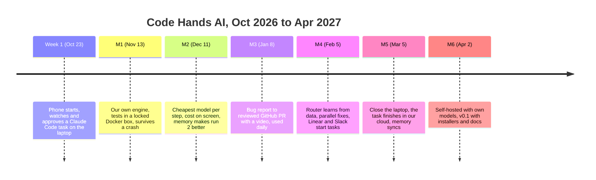

# Roadmap

Each phase ends with a milestone: something a person can do with the product that they could not do the month before. Someone who did not build it shows it on the demo day, from a fresh download. Details are in the [plan](../plan/six-month-sig-build-plan.md).

## Phases

| Phase | Dates | Theme | Demo | Real parts swapped in at the end |
| --- | --- | --- | --- | --- |
| Sprint | Oct 19 to 23 | Borrow everything, prove the loop | Start a task from a phone in another room, approve it, open the branch on the laptop | Runner, daemon, state API, both apps |
| 1. Our own engine | Oct 26 to Nov 13 | Replace borrowed pieces with ours | Fix a planted bug with our engine from the phone, kill the daemon halfway, it still finishes | Model gateway, memory repo map, telemetry, real daemon behind the app |
| 2. Cheaper and smarter | Nov 16 to Dec 11 | Model per step, cost, memory | The same five tasks twice: round two costs less and fails less | Static router, memory recall in the plan step, external agents as workflow steps |
| 3. Daily use | Dec 14 to Jan 8 | Real work, GitHub | A real issue becomes a reviewed PR with a video | Final ClientAPI, verify workflow, trace links, memory viewer |
| 4. Learn and scale | Jan 11 to Feb 5 | Data-driven routing, parallel candidates, connectors | 50 tasks: lower cost at the same pass rate. A Linear ticket becomes a PR | Router v1, parallel candidates, dispatcher, memory sync |
| 5. Cloud | Feb 8 to Mar 5 | Handoff between machines | Start on a laptop, close the lid, approve from the phone, same memory on a second laptop | Worker image, sync service, relay, hosted vLLM |
| 6. Self-host | Mar 8 to Apr 2 | Own servers, own models, release | One-command install on a fresh server, fix a bug with no outside AI | Compose and Helm, self-host gateway and sync, installers |
| Buffer | Apr 5 to 18 | Fix what slipped, final report | | |

Out of scope: billing, multi-tenant SaaS, fine-tuning in production, a full IDE, auto-merge.

Per person: [tahira.md](tahira.md). Other owners add theirs here.
