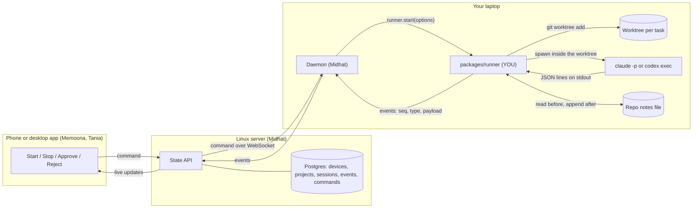
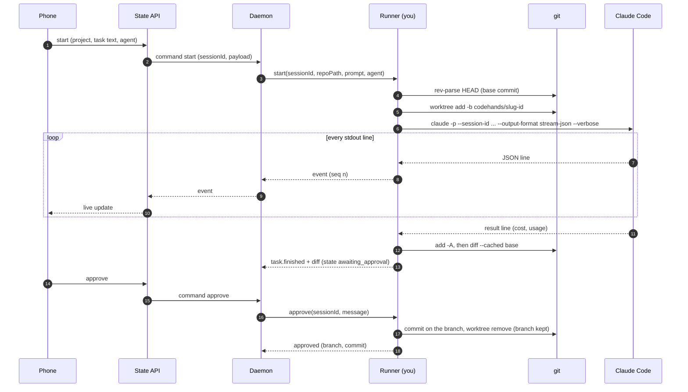
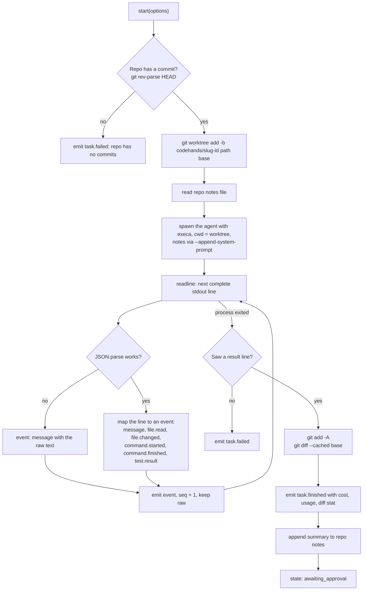
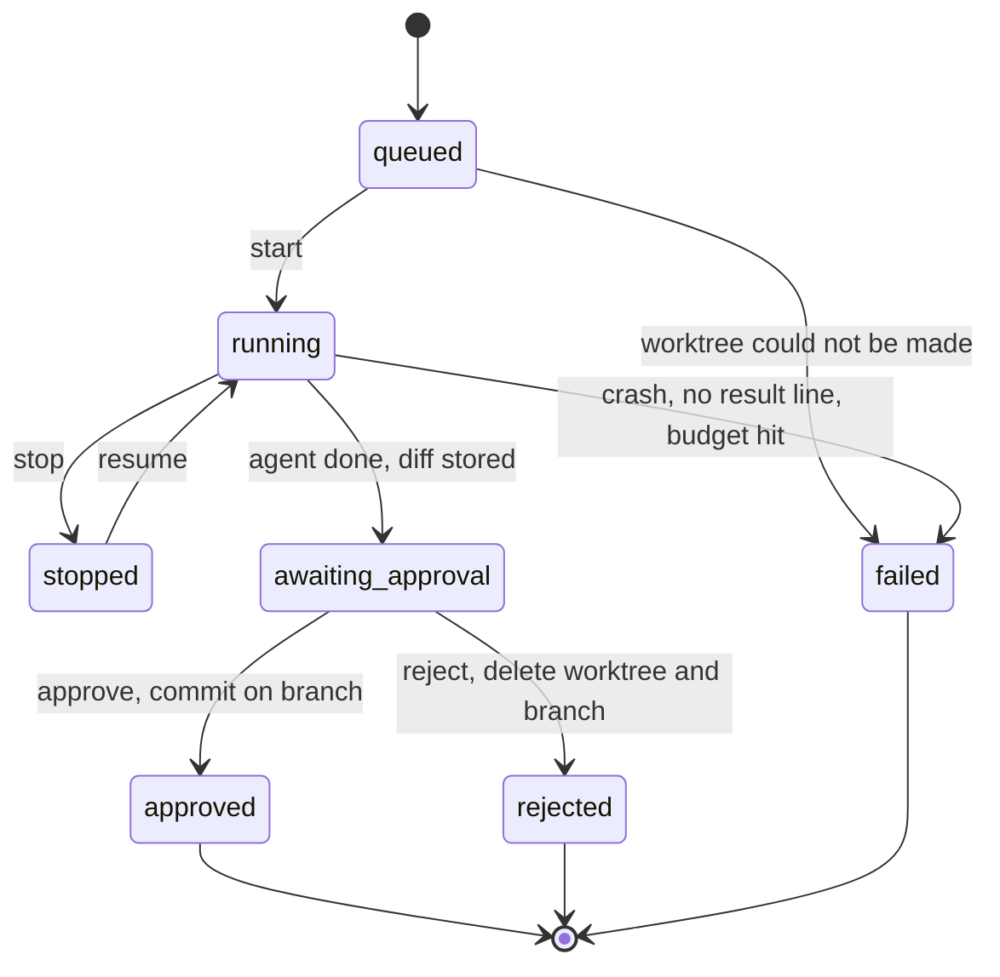
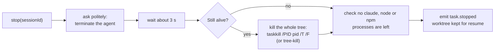

# Tahira: Week 1 guide (Oct 19 to 23, 2026)

**Your one deliverable:** the `codehands-runner` repo (was `packages/runner` in the monorepo, see [decision 0001](../../decisions/0001-separate-repos.md)). Given a repo and a prompt, it makes a private copy of the repo, runs Claude Code (or Codex) in it with no screen, turns its output into events, and lets someone stop, resume, approve or reject the change.

**Thursday sync and demo (Oct 22):** from the phone, a task runs on your laptop in its own copy of the repo, and approving it puts the change on a branch. Section 11 has the order of work that gets you there by Thursday, plus the demo script.

**Viewing the diagrams:** they're Mermaid. GitHub renders them as-is. In VS Code, install the "Markdown Preview Mermaid Support" extension, then open the preview with Ctrl+Shift+V.

You don't build the server, the apps or the upload to the cloud. Midhat's daemon calls your runner and ships your events up. Keep your package a plain library with a clean interface, and you never wait on anyone.

Flags below were checked against what is installed on your laptop: Claude Code 2.1.280, codex-cli 0.155.1, git 2.51, Node 22.18, Docker 28.3. Run `claude --help` and `codex exec --help` if anything behaves differently.

---

## 1. How the pieces fit this week

### 1a. The whole system this week: who talks to whom



Your part is the **Your laptop** box minus the daemon. Everything to the left of the daemon belongs to someone else, and you only meet them through the `runner.start(...)` call and the events you emit.

### 1b. One task from start to approve



### 1c. Inside the runner: what `start()` does



### 1d. Session states: the only legal moves



Anything not drawn here gets refused, e.g. approving a running task or resuming an approved one.

### 1e. Stop: why it takes four steps on Windows



- **Daemon → runner:** a function call (`start`, `stop`, `approve` …), not a network call.
- **Runner → daemon:** a stream of normalized events. The daemon stores and uploads them.
- **Runner → disk:** worktrees and the memory notes file. That's all it writes.

---

## 2. Sort out with Midhat on Monday morning (30 minutes, before writing code)

**What his daemon does today:** it lives in its own repo (`Midhat-kazmi/codehands-server`, npm). `codehands start` connects to the server over WebSocket and receives `{ type: "command", commandType: "start", sessionId, payload: { task } }`. It then sends fake events: `task.started`, `step.plan`, `step.implement`, `step.test`, `task.finished`. Each event takes 12 to 240 ms to reach the server and get stored.

1. **Repo.** Add him as a collaborator on `imtahirabatool/codehands-ai`. He moves his server into `apps/api` and his daemon into `apps/cli`, and switches to pnpm. Agree on the day.
2. **Event names.** Proposal (used throughout this guide): keep his `task.started` / `task.finished`, add `task.stopped` / `task.failed`, and use `message`, `file.read`, `file.changed`, `command.started`, `command.finished`, `test.result` for what happens in between (section 6). Claude Code doesn't report steps, so `step.*` waits for our own engine in week 2. Check that his events table has a `seq` column.
3. **The start command.** It needs more than `task`: `repoPath` (or a `projectId` the daemon turns into a path), `agent`, and optionally `model` and `budgetUsd`.
4. **Who owns persistence.** Proposal: the runner keeps only what it needs to resume (session id, worktree path, branch, base commit). The daemon owns SQLite and the upload.
5. **Session ids.** His server already makes the UUID. The runner reuses it as Claude's `--session-id`, so one id works everywhere.
6. **Where worktrees live.** Proposal: `~/.codehands/worktrees/<repoKey>/<sessionId>`, outside the repo so nothing nests.
7. **A fake runner.** He can plug it in today: a function that emits about 10 events in the agreed shape, 300 ms apart. Later, the same code replays `spike-1.jsonl` as your demo backup.

---

## 3. Day by day

Your sync and demo are on **Thursday**, so this week is reordered from the plan. Diff and approve (the demo's key moment) move to Wednesday. Codex and memory come after the demo. The Gantt chart in section 11 shows the same order.

### Mon Oct 19: setup, skeleton, reading, first spike

- [X] Laptop set up, monorepo skeleton (done)
- [X] Push the repo and send the link to the team
- [ ] Monday morning call with Midhat (section 2)
- [ ] Fake runner for Midhat, in the agreed event shape
- [ ] Sprint reading (section 9, about an hour)
- [ ] **Make a fixture repo** for the whole week, e.g. `~/codehands-fixtures/date-bug`: a tiny Node project with one function, one failing test and `npm test`. Talha's practice tasks come later, and you need one today.
- [ ] **Spike, by hand in a terminal:**

```bash
cd ~/codehands-fixtures/date-bug
git worktree add -b codehands/spike-1 ../wt-spike-1 HEAD
cd ../wt-spike-1
claude -p "Fix the failing test. Run npm test to check." \
  --output-format stream-json --verbose \
  --permission-mode acceptEdits --allowedTools "Bash(npm test:*)" \
  --max-budget-usd 0.50 > ../spike-1.jsonl
```

Open `spike-1.jsonl` and **read every line**. That file is the input to everything you build this week. Save it in `packages/runner/test/fixtures/` so your parser tests can replay it with no API cost.

### Tue Oct 20: the session runner (Urgent)

- [ ] `start()`: create the worktree, spawn `claude -p` in it, read stdout line by line, map each line to an event, emit it (diagram 1c)
- [ ] Record the base commit (`git rev-parse HEAD`) and the branch name at start
- [ ] Parser unit tests that replay `spike-1.jsonl`, plus a malformed line and a half-finished line
- [ ] **Plug-in with Midhat, end of day:** a task started from the terminal shows up live on the server

**Done when:** a task creates a git worktree, runs `claude -p` with stream-json output inside it, and each line becomes an event.

### Wed Oct 21: the change, approve, reject, then stop

- [ ] `diff()`: `git add -A` then `git diff --cached --binary <baseCommit>`, plus `--stat` for the summary. Store it on the session.
- [ ] `approve()`: commit in the worktree on its branch, then remove the worktree and keep the branch
- [ ] `reject()`: `git worktree remove --force <path>` and `git branch -D <branch>`
- [ ] Wire the `approve` and `reject` commands with Midhat, so the phone's buttons work
- [ ] `stop()`: kill the whole process tree (section 7 and diagram 1e), mark the session `stopped`, emit `task.stopped`
- [ ] Evening: one full rehearsal of the demo from the phone (section 11)

**Done when:** the session stores its diff, approve from the phone commits it to a branch named after the task, reject deletes the worktree, and stop leaves no processes behind.

### Thu Oct 22: resume, sync and demo, then Codex

- [ ] Morning: `resume()` spawns `claude -p --resume <sessionId> "<new or 'continue' prompt>"` in the same worktree
- [ ] Test: start, stop after the first tool call, check Task Manager for leftover `claude`, `node` or `npm` processes, resume, confirm it finishes
- [ ] Morning: reset the fixture repo, then one last rehearsal
- [ ] **Sync and demo** (script in section 11)
- [ ] Afternoon: start the Codex adapter, the same interface with a different parser (section 5)

**Done when:** the demo ran, and resume continues the same Claude Code session.

### Fri Oct 23: Codex, first memory, team demo

- [ ] Finish the Codex adapter. **Done when:** a task can choose Codex and runs the same way.
- [ ] First memory: the notes file per repo goes into every session, and a summary is appended after each one (section 8)
- [ ] Fix whatever came up at Thursday's sync
- [ ] Week 1 team demo: start, watch and approve a task from a phone, with its cost

---

## 4. Claude Code in headless mode: what you need to know

| Flag                                       | What it does for you                                                                                                                            |
| ------------------------------------------ | ----------------------------------------------------------------------------------------------------------------------------------------------- |
| `-p "<prompt>"`                          | Runs once with no UI and exits. Everything this week uses it                                                                                    |
| `--output-format stream-json`            | One JSON object per line, as things happen. **Needs `--verbose` with `-p`**                                                           |
| `--include-partial-messages`             | Token-by-token chunks. Skip this week, it's noisy                                                                                               |
| `--session-id <uuid>`                    | You choose the session id up front, so use the daemon's UUID                                                                                    |
| `--resume <id>` / `-r`                 | Continue that session in a new process. This is how resume works                                                                                |
| `--permission-mode <mode>`               | `acceptEdits` lets it edit files without asking. Choices: `acceptEdits`, `auto`, `bypassPermissions`, `manual`, `dontAsk`, `plan` |
| `--allowedTools` / `--disallowedTools` | e.g. `"Bash(npm test:*)"` lets it run tests but no other shell commands                                                                       |
| `--dangerously-skip-permissions`         | Allows everything. **Don't use it this week.** There's no Docker sandbox until week 2, so the agent runs directly on your machine         |
| `--max-budget-usd <n>`                   | Hard spend cap per run. Always set it, e.g. 0.50 while testing                                                                                  |
| `--model <name>`                         | The model the user picked in the app                                                                                                            |
| `--append-system-prompt <text>`          | Where the repo notes go (Friday). There is also a `-file` variant                                                                             |

**The lines you'll see** (check against your `spike-1.jsonl`):

- `{"type":"system","subtype":"init", "session_id", "model", "tools", "cwd" …}`: the first line. Emit `task.started`.
- `{"type":"assistant","message":{"content":[…]}}`: content blocks are `text` (emit `message`) or `tool_use` with `name` and `input`. `Read` → `file.read`, `Edit`/`Write` → `file.changed`, `Bash` → `command.started`.
- `{"type":"user","message":{"content":[{"type":"tool_result", …}]}}`: tool output. Emit `command.finished`. If the command was the test command, also emit `test.result` with pass or fail.
- `{"type":"result","subtype":"success" | "error_…", "total_cost_usd", "duration_ms", "num_turns", "usage", "session_id", "is_error", "result"}`: the last line. Emit `task.finished` with cost. **Memoona needs `total_cost_usd` and `usage` exactly as given.**

Always keep the raw line in the event's `raw` field. When the shape changes, nothing is lost and you only fix the mapping.

**Alternative to know about:** the Claude Agent SDK for TypeScript (`@anthropic-ai/claude-agent-sdk`, its `query()` function) gives you typed messages and an abort signal instead of parsing stdout. The plan says to wrap the CLI, and the CLI is what makes Codex and Aider fit the same pattern, so stick with the CLI this week. Read the SDK overview so you know the option exists for later.

---

## 5. Codex CLI: the second agent (Thursday afternoon and Friday, after the demo)

```bash
codex exec --json -C <worktree> -s workspace-write -m <model> "<prompt>"
codex exec resume <thread_id> --json "<prompt>"
```

| Flag                                 | Meaning                                                                               |
| ------------------------------------ | ------------------------------------------------------------------------------------- |
| `--json`                           | JSONL events on stdout                                                                |
| `-C, --cd <dir>`                   | Working root, so pass the worktree                                                    |
| `-s, --sandbox`                    | `read-only`, `workspace-write` or `danger-full-access`. Use `workspace-write` |
| `-m, --model`                      | Model                                                                                 |
| `-o, --output-last-message <file>` | Writes the final answer to a file, handy for the summary                              |
| `--ephemeral`                      | Don't save the session to disk. **Don't use it, it breaks resume**              |
| `exec resume <id>` / `--last`    | Resume                                                                                |

Codex's `--json` lines look roughly like: `thread.started` (with `thread_id`, so save it for resume), `turn.started`, `item.started` / `item.completed` (item types such as `agent_message`, `command_execution`, `file_change`, `reasoning`), `turn.completed` (with `usage`: input, cached and output tokens), `turn.failed` and `error`. Capture a real `codex-spike.jsonl` first, the same way you did for Claude.

**Codex reports tokens, not dollars.** Pass `usage` through untouched. Memoona's price list turns it into cost.

**Windows:** on your laptop `codex` is an npm shim (`codex.cmd`). Node's plain `spawn("codex")` fails on `.cmd` files, so use `execa` or `cross-spawn` (section 7).

---

## 6. Proposed shapes for `packages/contracts` (agree with Midhat on Monday, frozen Friday)

```ts
export type RunnerEventType =
  | "task.started" | "message" | "file.read" | "file.changed"
  | "command.started" | "command.finished" | "test.result"
  | "task.finished" | "task.failed" | "task.stopped";

export interface RunnerEvent {
  sessionId: string;
  seq: number;              // 1, 2, 3 … per session. Lets the phone catch up after a reconnect
  type: RunnerEventType;
  at: string;               // ISO time
  payload: Record<string, unknown>;
  raw?: unknown;            // the agent's original line, untouched
}

export interface StartOptions {
  sessionId: string;        // UUID from the daemon
  repoPath: string;
  prompt: string;
  agent: "claude-code" | "codex";
  model?: string;
  budgetUsd?: number;
}

export interface Runner {
  start(o: StartOptions): AsyncIterable<RunnerEvent>;
  stop(sessionId: string): Promise<void>;
  resume(sessionId: string, prompt?: string): AsyncIterable<RunnerEvent>;
  diff(sessionId: string): Promise<{ patch: string; stat: string }>;
  approve(sessionId: string, message: string): Promise<{ branch: string; commit: string }>;
  reject(sessionId: string): Promise<void>;
}
```

**Session states:** `queued → running → awaiting_approval → approved | rejected`. `running ⇄ stopped` through stop and resume, and any state can go to `failed`. Write this as one small function that refuses illegal moves, like approving a running session. Week 2's engine reuses the idea.

**Branch name:** `codehands/<short-task-slug>-<first 8 chars of sessionId>`, e.g. `codehands/fix-date-bug-3f2a9c1e`. It's readable and never collides.

---

## 7. The traps (read before Tuesday)

**Processes on Windows**

- Use [execa](https://github.com/sindresorhus/execa) or `cross-spawn` to start agents. They handle `.cmd` shims and quoting on Windows.
- **Killing the parent doesn't kill its children on Windows.** Claude runs `npm test`, which runs `node` … Kill the whole tree with `taskkill /PID <pid> /T /F`, or the [`tree-kill`](https://www.npmjs.com/package/tree-kill) package, which does that on Windows and process groups on Linux and macOS. Teammates on Mac will need it too.
- Stop politely first, then force it: send a terminate, wait about 3 s, then kill the tree.
- Read stdout with `readline` (`createInterface({ input: child.stdout })`). Output can arrive mid-line, and readline only hands you complete lines. Wrap `JSON.parse` in try/catch and emit a `message` with the raw text when parsing fails.
- Always handle `exit` **and** `error` (the binary isn't found) on the child process, and the case where the process dies with no `result` line → `task.failed`.

**git worktree**

- One branch can be checked out in only one worktree at a time. A clash is why `worktree add` fails. Always create a new branch: `git worktree add -b <branch> <path> <baseCommit>`.
- Worktrees share the repo's `.git`. Removing the folder by hand leaves stale entries, so use `git worktree remove` and run `git worktree prune` at startup.
- Windows path length: run `git config --global core.longpaths true` once, and keep worktree paths short.
- `git diff` ignores files git hasn't seen before (untracked). Run `git add -A` first, then `git diff --cached`.
- New repos with **no commits** can't make worktrees. Check `git rev-parse HEAD` and give a clear error.

**Safety this week (no sandbox yet)**

- Only run on our own repos (a plan rule for week 1).
- Use `acceptEdits` plus a short `--allowedTools` list, never skip permissions, and always pass `--max-budget-usd`.
- Repo files are untrusted from day 1: a README can tell the agent to do something bad. Week 4 has tests for this. For now just don't point the runner at repos you don't know.

**Keys**

- API keys and logins stay on the laptop. Never put them in events, logs or the diff.

---

## 8. First memory (Friday)

- **Where:** `~/.codehands/memory/<repoKey>/notes.md`, where `repoKey` = the first 12 chars of the sha1 of `git remote get-url origin` (or the absolute path if there's no remote).
- **In:** Claude gets `--append-system-prompt "<notes>"`. Codex gets the notes added to the top of the prompt. **Don't** write `CLAUDE.md` or `AGENTS.md` into the worktree, or they'd show up in the diff.
- **Out:** after `task.finished`, append:

```markdown
## 2026-10-23 · fix date bug · approved
- Test command: npm test
- What it changed: src/date.ts (timezone offset)
- Gotcha: tests need TZ=UTC
```

Build it from the `result` text, or make one cheap call (`claude -p --model haiku "Summarize in 3 bullets…"`).

- Keep the file under about 200 lines and drop the oldest entries first. Week 4 replaces this with real memory, so keep it simple.

---

## 9. Reading and watching

### Required this week (the sprint reading, about an hour)

| What                       | Why                                                     | Where                                                                                                              |
| -------------------------- | ------------------------------------------------------- | ------------------------------------------------------------------------------------------------------------------ |
| Claude Code headless mode  | `-p`, stream-json, resume: your Tuesday and Thursday | Claude Code docs → "Headless mode" / "Run Claude Code programmatically" (code.claude.com/docs)                    |
| Claude Code CLI reference  | Every flag in section 4                                 | Claude Code docs → "CLI reference"                                                                                |
| `git worktree` manual    | Your Tuesday and Wednesday                              | https://git-scm.com/docs/git-worktree                                                                              |
| Codex non-interactive mode | Thursday afternoon and Friday                           | Codex docs → "Non-interactive mode" (developers.openai.com/codex), or `docs/exec.md` in github.com/openai/codex |

If a link has moved, search the page title. These docs move often.

### Useful while building (look things up as you need them)

- **Node `child_process`** (spawn, stdio, `exit` vs `close`, signals): https://nodejs.org/api/child_process.html
- **Node `readline`**: https://nodejs.org/api/readline.html
- **execa README**, especially the sections on cancelling and killing processes
- **JSON Lines format**: https://jsonlines.org (it takes two minutes)
- **Claude Agent SDK overview**: the alternative from section 4, so you know it exists

### Code to study, people who already built this (pick one, spend 30 minutes)

| Project                                        | What to look at                                                                                                                                                             |
| ---------------------------------------------- | --------------------------------------------------------------------------------------------------------------------------------------------------------------------------- |
| **Vibe Kanban** (BloopAI/vibe-kanban)    | Runs Claude Code, Codex and others in a git worktree per task, which is almost exactly your week. Look at how it spawns agents, parses their output and cleans up worktrees |
| **Claude Squad** (smtg-ai/claude-squad)  | Several Claude Code sessions, each in its own worktree. Look at its worktree create and cleanup code                                                                        |
| **Crystal** (stravu/crystal)             | A desktop app that runs Claude Code in worktrees, close to the shape of our product                                                                                         |
| **Aider** `aider/coders/base_coder.py` | The agent loop. That's week 2 material, but skim it now                                                                                                                     |

### Optional, for weekends (from the Core learning kit, the deeper stuff)

- **Book:** *The Linux Programming Interface* (Michael Kerrisk). Ch. 20 to 22 on signals, ch. 26 on waiting for child processes, ch. 34 on process groups (why "kill the tree" works on Linux), ch. 64 on pseudoterminals (needed later for interactive agents with node-pty).
- **Book:** *Designing Data-Intensive Applications* (Kleppmann). The idempotence parts help with week 4's crash and resume. Not this week.
- **Next weekend's reading** (week 2, from the plan): Fireship's "Docker in 100 Seconds", the Docker getting started guide, the XState concepts page, the Drizzle SQLite quickstart. Spike: `npm test` in a container with 1 GB, no network and a 60 s limit.

### Research topics to keep in the back of your mind

1. **Process lifecycle:** signals vs. Windows Job Objects, orphan and zombie processes, and why a clean stop is hard.
2. **Streaming parsers:** line framing, backpressure, and what happens when a consumer is slower than the agent.
3. **git internals:** worktrees, the shared object store, refs. Read the "Git Internals" chapter of *Pro Git* (free at git-scm.com/book).
4. **State machines for jobs:** legal moves, and why "approve a running session" must be impossible.
5. **Prompt injection through repo content:** the main security risk for the whole product, with tests in week 4.

---

## 10. Checklists

### Before Thursday's demo (must have)

- [ ] A task started from the phone → events stream → shows live on the server and phone (with Midhat)
- [ ] Diff stored → approve from the phone → branch `codehands/…` exists with one commit → worktree gone
- [ ] Reject → worktree and branch gone
- [ ] Stop mid-task → Task Manager shows no leftover processes
- [ ] Every run has a `--max-budget-usd` cap
- [ ] Backup replay mode works, in case the live run fails

### Before Friday's team demo

- [ ] Resume after stop finishes the task
- [ ] Same flow with `agent: "codex"`
- [ ] Second task on the same repo starts with the notes from the first
- [ ] Parser tests replay recorded JSONL with no API calls, and `pnpm test` passes
- [ ] Event list merged into `packages/contracts` (frozen Friday)

---

## 11. Thursday sync and demo (Oct 22)

### The week reordered for a Thursday demo

The demo needs **start → watch live → approve**. Stop and resume are good to show, and Codex and memory can come after the demo, so they move to Thursday afternoon and Friday.

```mermaid
gantt
  title Week 1 with the demo on Thursday
  dateFormat YYYY-MM-DD
  axisFormat %a %d
  section Setup
  Monorepo skeleton                     :done,   m1, 2026-10-19, 1d
  Call with Midhat, reading, fixture, spike :     s1, 2026-10-19, 1d
  section Runner
  Session runner and parser tests       :        r1, 2026-10-20, 1d
  Plug-in with Midhat                   :milestone, p1, 2026-10-20, 0d
  Diff, approve, reject, then stop      :        r2, 2026-10-21, 1d
  Resume (morning), demo prep           :        r3, 2026-10-22, 12h
  Thursday sync and demo                :milestone, d1, 2026-10-22, 0d
  Codex adapter                         :        r4, 2026-10-22, 2d
  First memory                          :        r5, 2026-10-23, 1d
```

The day-by-day tasks for this order are in section 3, and the checklists in section 10.

### Demo script (about 3 minutes)

1. **One line on what it is:** "The runner takes a task, makes a private copy of the repo, runs Claude Code in it, and turns everything it does into live events."
2. **Start the task from the phone** on the fixture repo ("Fix the failing test").
3. **Show it live:** events appearing on the phone, and on your laptop `git worktree list` showing the new copy.
4. **Show the change:** the diff on the phone, and that `src/` in your real repo is untouched.
5. **Approve from the phone**, then on the laptop run `git log codehands/fix-date-bug-xxxx --oneline -1`. The commit is there, and the worktree is gone.
6. **The numbers:** cost of the run (`total_cost_usd`), how long it took, how many events.
7. **The status, in four lines:** done / not done / blocked by / next.

### Prepare on Wednesday night

- [ ] Run the whole demo once from the phone, start to finish
- [ ] Keep a **reset script** for the fixture repo so each rehearsal starts clean:

```bash
cd ~/codehands-fixtures/date-bug
git worktree prune
git branch --list 'codehands/*' | xargs -r git branch -D
git reset --hard && git clean -fd
```

- [ ] **A backup plan:** a replay mode that plays `spike-1.jsonl` back with its real timing (the same thing as Midhat's fake runner). If the network or Claude fails during the demo, switch to it and say so. "Cut scope, never the demo."
- [ ] Claude Code signed in, `--max-budget-usd` set, and no leftover processes in Task Manager
- [ ] Phone charged, signed in, and the session list open

### Bring these up at the sync

- **The event list:** agreed with Midhat, and it gets frozen on Friday in `packages/contracts`
- **Midhat's code** moving from `codehands-server` into `apps/api` and `apps/cli`: which day
- **Public or private repo,** and the licence (the plan leaves both to the lead)
- **Talha's practice tasks:** what format they should take so his scoring script can run them through the runner
- **One thing you're blocked on,** if any

### Things a reviewer may ask, with your short answers

| Question | Answer |
| --- | --- |
| Why a worktree and not a clone? | It's instant, it shares the repo's git history, and the real working copy is never touched |
| Can the agent break my machine? | This week it runs with edits allowed only inside the worktree and only `npm test` as a shell command. Week 2 adds the Docker sandbox |
| What does a run cost? | Claude Code reports the dollars itself (`total_cost_usd`). Codex reports tokens, and Memoona's price list turns those into dollars |
| What if the laptop dies mid-run? | This week: resume with `--resume <sessionId>` in the same worktree. Week 4: saved progress after every step |
| Why wrap Claude Code instead of building our own agent? | Week 1 proves the product loop end to end. Our own engine replaces it step by step from week 2, behind the same events |

---

## 12. Working in the repo, and more resources

### Day-to-day commands

```bash
git switch -c tahira/runner-start                      # one branch per Linear issue
pnpm --filter @codehands/runner add execa tree-kill    # runtime dependencies
pnpm --filter @codehands/runner add -D vitest          # tests
pnpm --filter @codehands/runner test                   # only your package
pnpm test                                              # everything, before you open a PR
```

- **PR titles** carry the Linear issue id, so merging closes the issue (from the plan's Linear setup).
- **Contract changes** (`packages/contracts`) need Midhat's approval, and the fake runner gets updated in the same PR.
- **Only edit your own folders** (`packages/runner`, and `packages/contracts` together with Midhat). For anything else, open a PR to its owner.

### More resources

| Topic | Resource | When |
| --- | --- | --- |
| Diagrams | Mermaid docs, mermaid.js.org (flowchart, sequence, state, gantt) | When you change these diagrams |
| Testing | Vitest getting started (vitest.dev) | Tuesday, for the parser tests |
| Spawning on Windows | execa README: "Windows", "Termination" sections | Tuesday |
| Process trees | `tree-kill` README, Microsoft docs for `taskkill` | Wednesday |
| Git | *Pro Git*, ch. 2 (basics) and ch. 10 (internals), free at git-scm.com/book | Weekend |
| Diffs | `git diff` manual: `--cached`, `--stat`, `--binary` | Wednesday |
| Agent output | Your own `spike-1.jsonl` and `codex-spike.jsonl` | All week, the most reliable source |
| Demos | The plan's rule: show something that runs, cut scope before cutting the demo | Thursday |
